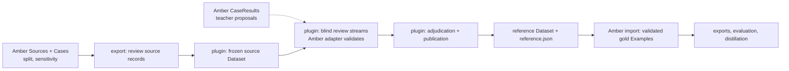

# Human review: mlflow-span-review integration

Status: design, 2026-10-28. Human review, gold capture, and correction use the author's
`mlflow-span-review` MLflow app (currently `aida-notes/plugins/mlflow-span-review`, v0.2.0). Amber
contributes a project adapter and import/export boundaries; it does not build its own annotation
app. The [v1 contract](02-v1-schemas-and-tools.md), [roadmap](04-roadmap.md), and
[current-progression protocol](protocols/oncology_current_progression-v1.md) remain authoritative.
Tasks are tracked in Beads (`bd ready`).

History: the 2026-10-07 loupe plan proposed a separate React/SQL annotation platform; it is kept
[as history](amber-docs-2026-10-07/loupe-implementation-plan.md). A Label Studio alternative was
rejected because it cannot natively represent Amber's claim/evidence graph and the plugin already
implements review custody. The separate `loupe` workbench repository is a different project; this
document does not use that name.

## Why this tool

The plugin already provides what the protocol's gold process needs and what a custom app would
take longest to get right:

- frozen source snapshots as native MLflow Datasets with verified `source_sha256`, exact
  code-point offsets, and Unicode-tested browser selection;
- independent blind review streams, authenticated identity through MLflow auth, and explicit
  adjudication with accepted/unresolved/excluded decisions and reasons;
- immutable, checksummed revisions, durable submission intents, and new reference Datasets on
  publication rather than in-place edits;
- a project `AnnotationAdapter` boundary (`build_result`, `validate_result`, `binding`) that owns
  annotation meaning, so Amber validation can run inside the review path;
- only the OSS MLflow surface, consistent with `CLAUDE.md` invariant 5.

## Integration design

- **Export.** Each Amber `Source` becomes a source record. Its `record_id` is `source_id` and its
  text is exactly `Source.text`. Its metadata carries the case ID, patient ID, frozen split,
  declared sensitivity, and the adapter policy version. Metadata never contains labels or
  proposals.
- **Amber adapter.** The adapter lives in Amber at `amber.review` and the plugin loads it by
  module path. It satisfies the plugin's Protocol by duck typing, so Amber never imports the
  plugin. `build_result` and `validate_result` construct and check a payload shaped like a
  `CaseResult`:
  - human-selected spans go through `exact_quote`;
  - answers go through `commit_claim`;
  - non-answers go through `no_claim`;
  - the whole graph is revalidated with the same boundary as `load_case_result`.

  This is the "human in the app" Inclusion path that invariant 1 permits. `binding()` hashes the
  Amber version and the adapter policy version.
- **Import.** A published `reference.json` becomes `Example`s through a validated loader, which
  re-checks every quote against the authoritative `Source`.
  - Accepted records become gold Examples.
  - Excluded and unresolved records are retained as diagnostics.
  - `annotators`, the adjudicator, and the considered/selected submission IDs fill
    `Example.annotators` and `derived_from_events`.
  - `Example` remains the single annotated-data source of truth. The reference Dataset is the
    review record, not a second training format.
- **Policy.** The MLflow server that holds source text is an annotation-service destination. The
  Amber policy gate must permit its zone for the dataset's sensitivity, and the dataset's
  license/IRB terms must allow it. That means institution-zone hosting for PHI, and the
  credentialed user's environment for CORAL.
- **Packaging.** An optional Amber extra installs the plugin from its standalone release. The
  core never depends on it. The plugin's current requirements (Python ≥3.12, MLflow
  3.17.x) must be reconciled with Amber's 3.11–3.12 range and its `tracking` extra.

## Plugin extensions required

These are changes to the plugin, made in its repository and tracked from Amber's Beads as
external work:

1. **Claim/outcome editor mode.**
   - A form generated from the task's `AnswerModel` JSON schema.
   - Per-field evidence citation from selected spans, plus a rationale.
   - An outcome selector covering answered and the three `no_claim` reasons; humans never
     choose `failed`.
   - The resulting claim → inference → inclusion graph displayed as a compact evidence view.

   Mention mode stays available for AIDA-style tasks.
2. **Proposals (correct mode).** Show linked teacher `CaseResult`s as editable proposals without
   putting them in source records. Keep a source-only stream for the manual-authoring arm and for
   blind gold review.
3. **Timing capture.** Record open/focus/idle/submit events per review so expert minutes come
   from the record rather than from self-reports.
4. **Restricted-data readiness.** Deployed identity, permissions, and independent backup are
   needed before CORAL or institutional notes are loaded (tracked in aida-notes as
   `aida-notes-62m.1.6`).
5. **Standalone release.** Extract the plugin from aida-notes (`aida-notes-b0z`) so Amber can
   depend on a versioned package.

## Study requirements carried from the protocol

- By default, gold uses two blind streams with distinct authenticated reviewers plus an
  adjudicator. The plugin already enforces distinct reviewers and complete streams before
  comparison. Under the protocol's move-on rule, a project may instead publish `single_review`
  references from one stream, or proceed with silver references. The tier is recorded per note
  before scoring.
- Assignments for the manual-vs-assisted comparison are seeded and counterbalanced. No reviewer
  authors and then corrects the same case, and gold reviewers or cases stay separate from the
  timing study.
- Test-split cases receive no model proposals until the configuration is frozen and the held-out
  run is recorded.
- Note text, quotes, and offsets never appear in logs or URLs. The plugin's existing source-safe
  design is retained.

## Open decisions

1. **Adjudication.** Is selecting one reviewed revision enough for claim gold? The alternative is
   merged authoring by the adjudicator, which the plugin does not yet support. The publication
   record must also carry the reference tier.
2. **Evidence view.** How much of the evidence graph does the editor show? A per-claim layered
   view is enough for the current task; a general graph editor is not needed.
3. **Contract amendment.** Map plugin revisions and submissions to `annotation_events` and to
   human status transitions (Beads: contract task).
