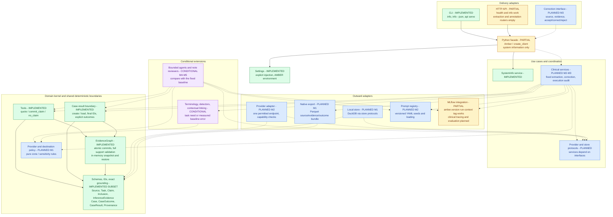
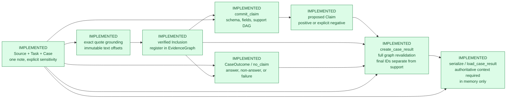

# Architecture and implementation status

Snapshot: 2026-10-07, after the case-outcome/result increment in commit `6334b89`.
This is a visual companion to the canonical [implementation inventory](README.md#current-implementation),
[architecture](00-goals-and-architecture.md), and [v1 contract](02-v1-schemas-and-tools.md).
Refresh the diagrams from that inventory when capabilities change.

Green means implemented within the stated scope; amber means partially implemented; blue means
planned; purple means conditional on measured benefit. Status text also appears in each node.
Implemented here means working code covered by synthetic tests, not clinical validation.

## Component architecture

Arrows show calls or dependencies, pointing from the caller toward what it uses. Solid arrows
exist today; dashed arrows describe planned integration. Optional adapters stay outside the
domain kernel, and the kernel never imports delivery, storage, or model runtimes.

The facade and HTTP/CLI adapters do not currently expose clinical runs. Python callers use the
implemented tools and case-result functions directly. Policy, provider, store, export, and
prompt-registry modules currently contain placeholders; installing their dependency extras does
not implement them. The implemented MLflow tag has no source-bearing clinical tracing path.

Policy is a prerequisite for every model/EDW call and every source-bearing destination transfer,
including telemetry, judges, artifact stores, and annotation services. The diagram groups those
boundaries for readability; no dashed edge represents an authorized or working transfer today.

## Current in-memory evidence workflow

These arrows show data flow. The entire flow exists today for caller-supplied inputs. A model
runtime does not yet produce the candidate values, quotes, review declarations, or failures.

`answered` requires nonempty final IDs naming known, non-rejected claims. The four other outcomes
(`not_mentioned`, `conflicting_evidence`, `insufficient_evidence`, `failed`) require no final IDs;
valid supporting claims can still be retained. `no_claim` creates only the three clinical
non-answer outcomes; callers construct execution failures with a failure kind. A not-mentioned
outcome requires declared complete review of the case note. Scope checks do not prove that the
review was complete, that cited evidence conflicts, or that a claim is clinically supported.

## Preparation, annotated data, and evaluation

| Area | Current status | Next boundary |
|---|---|---|
| Progression task | Protocol and strict boolean answer schema implemented | Independent clinical adjudication and prospective acceptance gates remain unevaluated |
| CORAL preparation | BRAT parser/audit, candidate rules, and split/manifest tooling implemented; local split recorded in the inventory | Draft mapping adapter is not functional; candidates are not task gold or Amber Examples |
| Annotated data | `Example`, append-only human review events, and verified/gold transitions planned | `Example` becomes the single annotated-data source of truth; failed runs cannot become gold |
| Clinical evaluation | Metrics, semantic-support review, and expert-effort comparison planned for M2-M3 | Evaluate the fixed baseline, then manual authoring versus assisted correction at matched quality |
| Additional domain scope | Mention and StructuredEvidence models planned; CaseResult mentions must currently be empty | Add with implementations and invariant tests when the selected use case requires them |
| Patient-wide scope and interoperability | PatientFact, temporal aggregation, FHIR, and additional backends deferred; OMOP NOTE_NLP conditional | Preserve patient IDs and effective datetimes without expanding the current single-note graph |

CORAL preparation stays under [experiments/coral](../experiments/coral/README.md); core code never
imports experiments. Its credentialed, deidentified data and local manifests are restricted,
ignored artifacts. No corpus records or manifests were inspected to create this diagram.

M0's interfaces exist and M1 is partly implemented. The remaining delivery order is policy and
local persistence/annotated-data boundaries, one permitted fixed baseline in M2, then minimal
correction and measured expert effort in M3. Agents, broad NLP, and additional runtimes follow
measured benefit. See the [roadmap](04-roadmap.md) for milestone requirements.

The implemented flow is covered by the [synthetic test suites](../tests/README.md) and
[installed core smoke example](../scripts/check_core_install.py). Code entry points are
[schemas](../src/amber/schemas/__init__.py), [grounding](../src/amber/grounding.py),
[graph](../src/amber/graph.py), [commit](../src/amber/tools/commit.py),
[outcomes](../src/amber/tools/outcomes.py), and [case results](../src/amber/cases.py).
