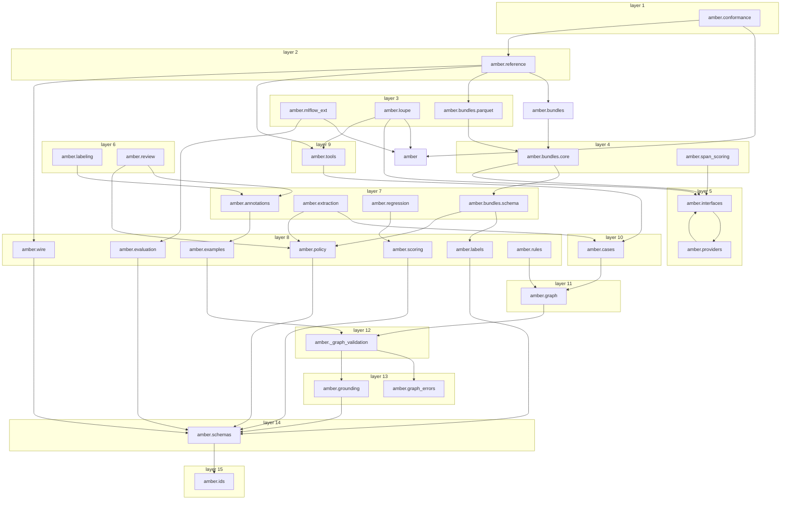

# Module dependencies

Generated by `scripts/deps_graph.py` from the import graph; do not edit by hand. Each box
is a layer of the `layers` contract in `.importlinter`, top first. An arrow is an import
that no longer path implies; the table below lists every direct import, type-checking
imports included. See [ADR 0001](../decisions/0001-dependency-layering.md).

| Module | Imports |
|---|---|
| `amber.conformance` | `amber`, `amber.annotations`, `amber.bundles`, `amber.bundles.core`, `amber.bundles.parquet`, `amber.bundles.schema`, `amber.cases`, `amber.examples`, `amber.graph`, `amber.graph_errors`, `amber.grounding`, `amber.ids`, `amber.interfaces`, `amber.labeling`, `amber.policy`, `amber.providers`, `amber.reference`, `amber.review`, `amber.rules`, `amber.schemas`, `amber.wire` |
| `amber.reference` | `amber.annotations`, `amber.bundles`, `amber.bundles.parquet`, `amber.cases`, `amber.examples`, `amber.extraction`, `amber.graph`, `amber.graph_errors`, `amber.ids`, `amber.interfaces`, `amber.labeling`, `amber.policy`, `amber.providers`, `amber.review`, `amber.rules`, `amber.schemas`, `amber.scoring`, `amber.tools`, `amber.wire` |
| `amber.mlflow_ext` | `amber`, `amber.annotations`, `amber.cases`, `amber.evaluation`, `amber.examples`, `amber.extraction`, `amber.graph_errors`, `amber.ids`, `amber.interfaces`, `amber.labeling`, `amber.policy`, `amber.providers`, `amber.schemas`, `amber.scoring` |
| `amber.loupe` | `amber`, `amber.annotations`, `amber.cases`, `amber.examples`, `amber.graph`, `amber.graph_errors`, `amber.grounding`, `amber.ids`, `amber.interfaces`, `amber.policy`, `amber.review`, `amber.schemas`, `amber.tools` |
| `amber.bundles.parquet` | `amber.bundles.core`, `amber.bundles.schema`, `amber.ids`, `amber.schemas` |
| `amber.bundles.core` | `amber.annotations`, `amber.bundles.schema`, `amber.cases`, `amber.examples`, `amber.grounding`, `amber.ids`, `amber.interfaces`, `amber.labels`, `amber.policy`, `amber.schemas` |
| `amber.span_scoring` | `amber.interfaces`, `amber.schemas`, `amber.scoring` |
| `amber.interfaces` | `amber.annotations`, `amber.extraction`, `amber.labeling`, `amber.policy`, `amber.providers`, `amber.review`, `amber.rules`, `amber.schemas`, `amber.scoring` |
| `amber.providers` | `amber.interfaces`, `amber.policy`, `amber.schemas` |
| `amber.labeling` | `amber.annotations`, `amber.schemas` |
| `amber.review` | `amber.annotations`, `amber.examples`, `amber.graph_errors`, `amber.grounding`, `amber.policy`, `amber.schemas` |
| `amber.annotations` | `amber._graph_validation`, `amber.examples`, `amber.ids`, `amber.schemas` |
| `amber.extraction` | `amber.cases`, `amber.graph`, `amber.policy`, `amber.schemas` |
| `amber.regression` | `amber.ids`, `amber.schemas`, `amber.scoring` |
| `amber.bundles.schema` | `amber.labels`, `amber.policy`, `amber.schemas` |
| `amber.examples` | `amber._graph_validation`, `amber.ids`, `amber.schemas` |
| `amber.labels` | `amber.ids`, `amber.schemas` |
| `amber.policy` | `amber.ids`, `amber.schemas` |
| `amber.scoring` | `amber.ids`, `amber.schemas` |
| `amber.wire` | `amber.ids`, `amber.schemas` |
| `amber.evaluation` | `amber.schemas` |
| `amber.rules` | `amber.graph`, `amber.graph_errors`, `amber.ids`, `amber.schemas` |
| `amber.tools` | `amber.cases`, `amber.graph`, `amber.grounding`, `amber.schemas` |
| `amber.cases` | `amber._graph_validation`, `amber.graph`, `amber.ids`, `amber.schemas` |
| `amber.graph` | `amber._graph_validation`, `amber.graph_errors`, `amber.ids`, `amber.schemas` |
| `amber._graph_validation` | `amber.graph_errors`, `amber.grounding`, `amber.ids`, `amber.schemas` |
| `amber.grounding` | `amber.ids`, `amber.schemas` |
| `amber.schemas` | `amber.ids` |
| `amber.bundles` | `amber.bundles.core`, `amber.bundles.schema` |
