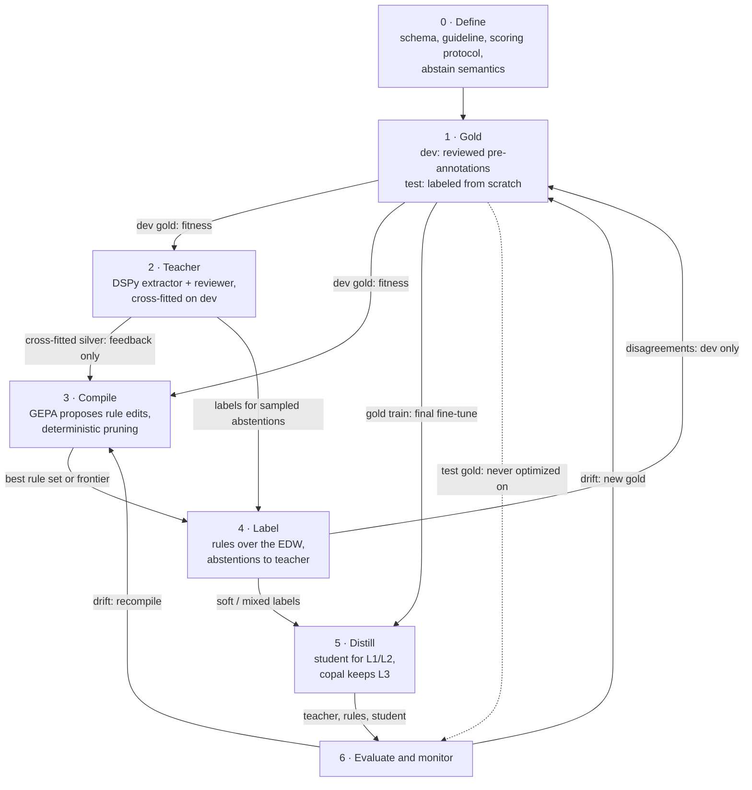
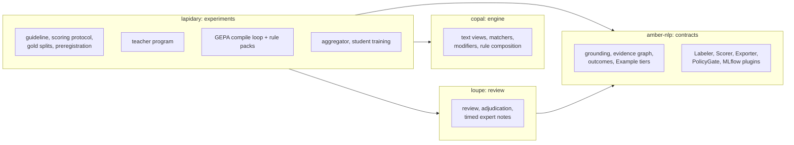
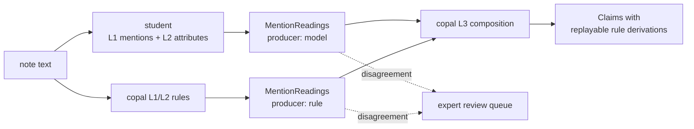
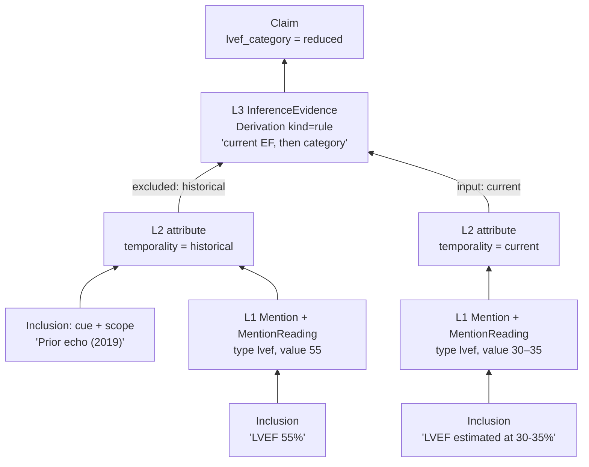
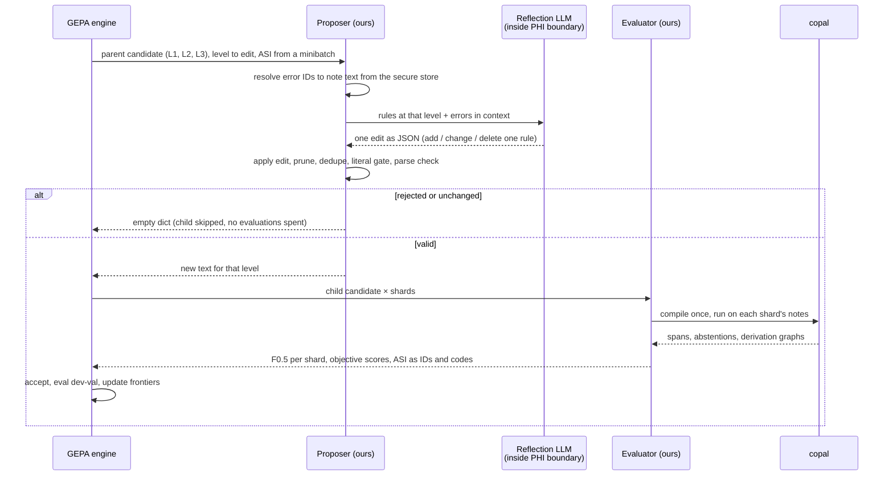
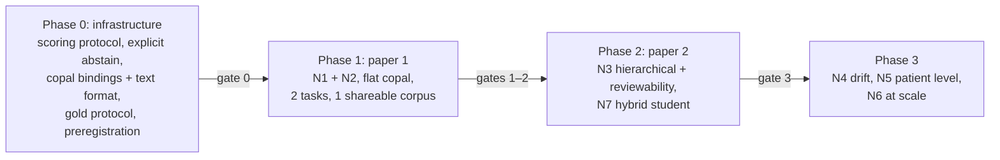
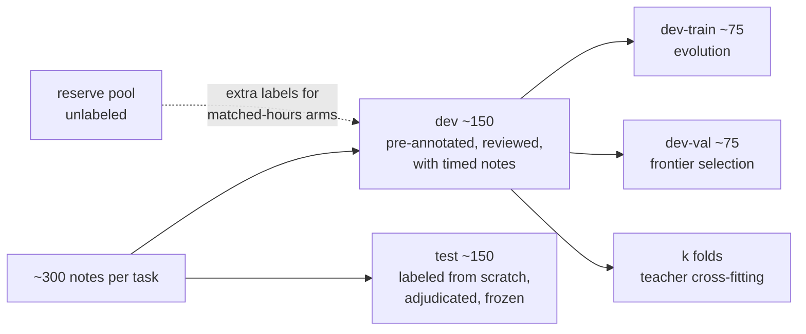

# Compiled Clinical IE: Expert-Guided Evolution of Hierarchical Rules

**Status:** research proposal, not a contract. The work it describes lives in lapidary (experiments),
copal (rule engine), and loupe (review). It is filed here because every artifact it produces must
conform to amber contracts. Nothing in this document changes [contracts.md](../contracts.md).

**Revision 2** (2026-11-02) follows a critical review. The main changes:

- The work is phased; the first study needs only flat copal.
- Abstention is an explicit rule output.
- The first study adds a second task, a shareable corpus, missing baselines, and controls for
  the expert-reasoning ablation.
- A new section lists the validity safeguards.
- The student is redesigned to work alongside the copal rules instead of competing with them.

**Revision 3** (2026-11-02):

- The second paper-1 task is fixed as HF symptoms.
- A literature search narrowed the novelty claims ([§2.1](#21-closest-work-from-the-literature-search),
  [§7](#7-novelty-claims)).
- The GEPA design is corrected against the library source ([§6.4](#64-evaluator-and-proposer-sketch),
  [§6.5](#65-gepa-fit-and-workarounds)).

**Revision 4** (2026-11-02):

- A new section relates the design to DSPy, GEPA, and EvoPool
  ([§2.2](#22-relation-to-dspy-gepa-and-evopool)).
- The §6.1 novelty callout names L3 as a symbolic aggregator over L1/L2 rule pools.
- §6.3 states that the proposer is stateless by design.

## Summary

Clinical experts and a frontier LLM define an extraction standard once. An evolutionary search
then **compiles** that standard into hierarchical rules written in copal's rule language. The
rules are fast, deterministic, run on CPU inside the PHI boundary, and can be read by
clinicians. They label the enterprise data warehouse (EDW) at scale and supervise a small
distilled model. Each copal rule fires on exact spans and feeds into higher-level rules, so
the record of how a rule reached its answer (its *derivation*) *is* an amber evidence graph.
Grounding comes by construction, not by after-the-fact attribution.

The pipeline shape (LLM → programmatic labels → distilled model) is established. EvoPool (2026)
already evolves labeling functions against a validation set and distills them. LLMs already
write flat clinical regexes in one shot (PromptNLP, 2026), and CACHE-ED2 (2026) compiles LLM
extraction logic into a DSL for business documents. This proposal claims novelty in four
narrower places:

1. **Gold-driven evolution of span-level, grounded rules** with assertion and temporality.
   Prior evolution covers discrete labels only; prior LLM-written clinical rules are one-shot
   and flat.
2. **Free-text clinician adjudication notes as the optimization signal**, valued per
   clinician-hour against proper controls. Earlier explanation-based supervision used
   grammar-constrained explanations, not free text read by an LLM.
3. **A hierarchical, derivation-producing clinical assertion language as the compile target**,
   whose derivations are evidence graphs that clinicians review. A distilled student can take
   over the lower rule levels (finding mentions) while copal keeps the upper level (combining
   them into answers).
4. **Real EHR conditions**: drift across years, note types, and sites, plus patient-level
   roll-up.

The work runs in phases ([§8](#8-phasing-and-decision-gates)). **Paper 1 tests claims 1 and 2**
with flat copal rules on two tasks, one of them on a shareable corpus. Hierarchical rules, the
hybrid student, drift, and patient-level work follow.

Two principles hold throughout:

- **Expert effort comes first** (a guideline, a scoring protocol, and a small gold set), not
  last.
- **Gold is the only fitness signal.** Teacher-produced silver labels supply training volume
  and feedback, never fitness.

> 🔷 **Novelty callouts** mark the places where this work goes beyond prior art. Everything else
> is established technique, assembled deliberately.

## Contents

1. [Background and terms](#1-background-and-terms)
2. [Prior art and the gap](#2-prior-art-and-the-gap)
3. [The workflow](#3-the-workflow)
4. [Where the work lives](#4-where-the-work-lives)
5. [Stages in detail](#5-stages-in-detail)
6. [copal as the compile target](#6-copal-as-the-compile-target)
7. [Novelty claims](#7-novelty-claims)
8. [Phasing and decision gates](#8-phasing-and-decision-gates)
9. [Paper 1 design](#9-paper-1-design)
10. [Validity safeguards](#10-validity-safeguards)
11. [Risks and mitigations](#11-risks-and-mitigations)
12. [Open questions](#12-open-questions)
13. [Bibliography](#13-bibliography)

**Where to start:**

- If you know the weak-supervision and GEPA literature, skip to [§3](#3-the-workflow).
- For the research claims and the first study, read [§7](#7-novelty-claims) through
  [§10](#10-validity-safeguards).

---

## 1. Background and terms

The proposal combines three lines of work:

- **Weak supervision.** Instead of hand-labeling training data, write many noisy *labeling
  functions* (small rules that vote or abstain on each example). Then combine their votes with
  a *label model* into probabilistic training labels (Snorkel, Data Programming). Sequence
  labeling, where the votes are spans, needs span-aware label models (Safranchik et al.;
  Lison et al., skweak).
- **LLM-compiled systems.** Use an LLM at build time to write a program, then run the program
  without the LLM (Compiled AI, DSPy). ALCHEmist and Evaporate do this for labeling functions.
- **Reflective evolution.** GEPA mutates a text artifact (a prompt, or here a rule set),
  evaluates it, and feeds diagnostic text back to an LLM that proposes the next mutation. Its
  `optimize_anything` API accepts any serializable artifact.

| Term | Meaning in this document |
|---|---|
| **Compile** | Turn expert and LLM knowledge into a deterministic rule set that runs with no LLM. |
| **Teacher** | The LLM extraction program (DSPy extractor plus reviewer) that produces silver labels. |
| **Student** | The small distilled model (an encoder span tagger). |
| **Gold** | Expert-reviewed references. In amber terms, `Example`s at tier `adjudicated` or `single_review`. |
| **Silver** | Unreviewed references from the teacher or rules. amber tier `silver`. |
| **dev / test** | The two gold splits. *dev* is the optimizers' fitness signal; *test* is never seen by any optimizer, and its notes are labeled without pre-annotation. |
| **Cross-fitted teacher** | Teacher output on a dev note produced by a teacher tuned *without* that note ([§10](#10-validity-safeguards)). |
| **ASI** | GEPA's *actionable side information*: the diagnostic text an evaluator returns to the reflection LLM (errors in context, which rule fired, expert notes). |
| **Frontier** | The set of evolved rule sets that no other candidate beats on every objective (a Pareto frontier). |
| **Level** | A layer of the rule hierarchy: L1 mention matchers, L2 modifiers, L3 note-level composition, L4 patient-level roll-up ([§6.1](#61-hierarchical-rules-as-evidence-graphs)). |
| **Silent** | The rule set finds no target in a note. |
| **Abstain** | The rule set finds the target but explicitly declines to answer, citing the span and a reason ([§6.2](#62-explicit-abstention)). Distinct from silent, and never a negative. |
| **Assertion** | Whether a mention is affirmed, negated, hypothetical, historical, or about someone else (experiencer), as in ConText. |

amber vocabulary (`Inclusion`, `Mention`, `MentionReading`, `InferenceEvidence`, `Derivation`,
`Claim`, `CaseOutcome`, `Example`) follows [contracts.md](../contracts.md) and
[contract-v0.1.md](contract-v0.1.md).

---

## 2. Prior art and the gap

| Ingredient | Prior art | Status |
|---|---|---|
| LLM writes code at compile time; deterministic runtime | Compiled AI (Trooskens et al., 2026); DSPy (Khattab et al., 2023/24) | Established paradigm |
| LLM-synthesized labeling functions + weak supervision | ALCHEmist (Huang et al., 2024); Evaporate (Arora et al., 2023); DataSculpt (Guan et al., 2025); EXPONA (Lam et al., 2026); Alfred (Yu & Bach, 2023) | Established; one-shot synthesis is weak on specialized tasks |
| **Iterative** labeling-function refinement from validation feedback | LGIWL (2025); **EvoPool (Xu et al., 2026)** | Established for **classification and relation extraction** |
| Weak supervision for sequence labeling | Safranchik et al. (2020); Lison et al. (2020, 2021) | Established; aggregation of span votes |
| Reflective evolution of code artifacts | GEPA / `optimize_anything` (Agrawal et al., 2025/26) | Established tool |
| LLM writes clinical extraction rules (one shot, flat) | Hwang et al. (2026, PromptNLP regexes); Shi & Bucher (2025, rule-based NER lexicons) | Established for flat value extraction |
| LLM compiles extraction logic into a DSL, refined from corrections | CACHE-ED2 (Bhoi et al., 2026) | Established for business documents |
| Annotator explanations as supervision, valued per annotator-hour | BabbleLabble (Hancock et al., 2018); TriggerNER (Lin et al., 2020) | Established, with grammar-constrained explanations |
| Clinical LLM silver labels → small model | Hsu & Roberts (2024); SHIELD (2026); LLM→BERT clinical NER distillation (2025); synthetic data distillation (2025) | Established |
| Clinical weak supervision with ontologies and rules | Trove (Fries et al., 2021); Snorkel lineage | Established |

**The closest work is EvoPool.** It evolves a pool of Python labeling functions against a
validation set and distills the result into RoBERTa, Qwen, and Llama models. It leaves three
openings:

1. It targets tasks expressible as discrete-label Python rules and states that extractive
   tasks are out of scope.
2. It removes the human author entirely.
3. It evaluates on public English benchmarks, with no drift, site, or note-type shift.

This proposal sits in those three openings, but other work crowds each of them
([§2.1](#21-closest-work-from-the-literature-search)).

### 2.1 Closest work from the literature search

A targeted search (2026-11-02) found no work that combines the full set:

- an LLM evolving rules in a hierarchical, derivation-producing clinical rule language;
- optimization against gold spans and clinician adjudication notes;
- span-level extraction with assertion and temporality.

Each part has close precedent, so **N1, N2, and N3 are weakened, none refuted**. The claims in
[§7](#7-novelty-claims) are narrowed accordingly.

| Threat | Work | What it already does | What it leaves to us |
|---|---|---|---|
| High (N1) | Hwang et al. 2026, PromptNLP (*Sleep Advances*) | LLM writes regexes for clinical scores across three institutions, adapted across sites; beats manual regexes | One shot, flat regex; no assertion, temporality, or gold-driven evolution |
| High (N3) | Bhoi et al. 2026, CACHE-ED2 (EMNLP Industry) | LLM agent compiles extraction into a DSL program, executed without the LLM, refined from analyst corrections | Business documents with fixed fields; no spans, assertion, or evidence graph; feedback value not measured |
| High (N1) | Shi & Bucher 2025 (arXiv:2506.16628) | LLM builds the lexicon layer of a rule-based clinical NER pipeline | First two pipeline steps only; no optimization loop or modifiers |
| Motivating (N1) | Maurya et al. 2025 (CODS-COMAD) | One-shot LLM labeling functions for NER: best F1 16.66 | The negative result evolution must overcome |
| High (N2) | Hancock et al. 2018, BabbleLabble (ACL); Lin et al. 2020, TriggerNER (ACL) | Annotator explanations beat labels per unit of annotator time (5–100× in BabbleLabble) | Grammar-constrained or trigger explanations, not free-text clinician notes consumed by an LLM optimizer |
| Medium (N1) | Aldeia et al. 2025 (MLHC) | Iterative LLM synthesis of computable phenotypes against labels | Structured data, patient level, not text spans |
| Medium (N2) | Hein et al. 2025 (*npj Digit Med*); Zhang et al. 2022, PRBoost (ACL) | Expert error analysis or accept/reject in the loop | Refines prompts or classification rules; value not quantified |
| Medium (N3) | Yan et al. 2024 (JAMIA); Zhang 2026 (verification of LLM-compiled rules) | Expert review of LLM-drafted phenotypes; checking LLM-compiled rules against their source | Structured data or business rules; no clinical span rules |
| Baseline | Byrd et al. 2013 (*Int J Med Inform*) | Hand-built Framingham HF rules: mentions with affirmed/denied status, then an encounter label; mention F1 0.910 | The two-level architecture exists by hand; we compile it |
| Baseline | Workman et al. 2024 (*Prog Cardiovasc Dis*) | VA HF symptom snippets labeled by two clinicians; GPT-4 zero-shot F1 0.95 vs. 0.655 for rules and ML | Suggests a strong teacher and a large rule gap to close |

### 2.2 Relation to DSPy, GEPA, and EvoPool

All three use an LLM as an optimizer over discrete text artifacts, scored against a small
labeled set, with the expensive reasoning done once. They differ in what is optimized.

| | DSPy | GEPA | EvoPool | This proposal |
|---|---|---|---|---|
| **Optimized artifact** | Prompts, demos, weights of a fixed LM program | Any text candidate | A pool of small annotator programs | A copal rule set, one component per level |
| **Runtime** | Still calls an LM | LM call or code | Pool + learned aggregator → labels → model | copal on CPU, no LM |
| **Candidate's job** | Solve the task | Solve the task | Cover a slice; abstaining allowed | Solve the task; *rules within it* cover slices |
| **Fitness** | Program metric | Per-example scores; Pareto frontier | Pool-level: precision floor, diversity, marginal contribution | Shard-level F0.5 and objectives; marginal contribution per rule in pruning |
| **End state** | One program | Frontier; merge pushes toward one | Many specialists + aggregator | Best rule set (default); frontier as ablation |

**Best program versus best committee.** GEPA is single-solution search; its frontier keeps
diverse candidates alive for exploration, and each candidate tries to be a complete solution.
EvoPool builds an ensemble in the data-programming lineage: a rule that fires on 2% of notes at
95% precision is a good member though a poor standalone candidate, which is why its gate scores
marginal contribution to the pool and why it needs a learned aggregator.

**This design is a hybrid.** GEPA searches over whole rule sets. Inside each rule set, the
Stage 3 clean-up (prune by marginal contribution, dedupe by firing pattern, precision floor)
applies EvoPool's committee logic *to the rules within one program*. The hierarchy then
replaces EvoPool's learned aggregator: L1 matchers behave like a pool of specialists, and L3
composition combines their output with an inspectable, replayable rule
([§6.1](#61-hierarchical-rules-as-evidence-graphs)). This is the principled reason Stage 4
defaults to the best single rule set: aggregation already happens inside L3.

**Lineage.** The two lines developed largely in parallel. EvoPool positions itself against
ALCHEmist, DataSculpt, Snorkel, and agent-evolution work; its reference list does not include
DSPy or GEPA. GEPA comes from the DSPy line and positions itself against prompt optimizers and
RL methods.

---

## 3. The workflow



Read the diagram for four properties:

- **Gold is the only fitness signal.** Both optimizers score against dev gold. Silver reaches
  the compiler only as explanation, and only from a cross-fitted teacher.
- **Test gold reaches only evaluation.** No optimizer sees it. Stage 6 evaluates every artifact
  (teacher, rule sets, and student).
- **Selected notes never enter test.** Notes chosen by active learning join dev; test stays a
  frozen, stratified-random sample per gold-set version.
- **There are two loops.** Disagreements go back to experts as new dev gold, and drift triggers
  both new gold and recompilation.

---

## 4. Where the work lives

Following the [charter](../charter.md#ecosystem), amber-nlp owns contracts and checks, not
pipelines.



| Need in this proposal | Provided by | Status |
|---|---|---|
| Exact spans and grounding | amber `quote()`, `mention()` | `quote` exists; `mention` planned (contract v0.1 §2) |
| copal span → amber mention | copal adapter (contract v0.1 §2.4) | Planned |
| Rule derivations as evidence, with replay | `InferenceEvidence.derivation` with `kind="rule"` (contract v0.1 §3.4) | Planned |
| Gold / silver separation | `Example` reference tiers (contract v0.1 §4.2) | Planned |
| "Never score a system against its own silver" | `Scorer` configuration check (contract v0.1 §4.2) | Planned |
| Expert review, adjudication notes, review timing | loupe via the review bridge | Planned |
| Reflection LLM and run artifacts inside the PHI boundary | `PolicyGate`: zone × sensitivity and destination checks | Planned |
| `NOTE_NLP` export | `Exporter` interface | Planned |
| Python bindings, rule-set text format, explicit abstain output | copal | **Not built**; Phase 0 ([§8](#8-phasing-and-decision-gates)) |
| Hierarchical rule sets with derivation output | copal | **Not built**; Phase 2 |
| Patient-level roll-up | — | **Charter non-goal** until a contract adopts it |

---

## 5. Stages in detail

Each stage lists what it produces and how that output is represented. The safeguards that
protect evaluation are collected in [§10](#10-validity-safeguards).

### Stage 0: Define

- Experts agree the schema, the annotation guideline, and what counts as evidence: mention
  spans, assertion, temporality, and inference steps. Most disagreement in clinical IE is about
  definitions, so the up-front expert time goes here.
- **Scoring protocol**, fixed before any system runs:
  - span matching: exact, or overlap with a stated rule;
  - value normalization: "30-35%", "30–35", and "~30%" must have defined canonical forms;
  - how a correct span with a wrong assertion is counted;
  - how silent and abstain outputs are scored.
- **Abstain semantics:** which situations the guideline treats as undecidable from the note
  ([§6.2](#62-explicit-abstention)).
- **Expert-note template**, so adjudication notes are comparable: *which guideline clause
  applies; which cue in the text decided it.*
- **Outputs:** a Pydantic answer model and task definition (in lapidary), a versioned
  guideline, and a versioned scoring protocol.

### Stage 1: Gold

- Experts adjudicate a sample stratified by note type, service, year, and ideally site.
- **dev** notes are reviewed as teacher pre-annotations in loupe. **test** notes are labeled
  from scratch, so the test set does not inherit the teacher's anchoring bias.
- On every dev correction, experts write a templated note. loupe records the time spent on
  labels and on notes separately; [§10](#10-validity-safeguards) explains why.
- A subset is double-annotated to report inter-annotator agreement (IAA), the ceiling every
  F1 should be read against.
- **Splits:**
  - **dev**: the fitness signal, further split into dev-train (minibatches for evolution) and
    dev-val (frontier selection), and into folds for cross-fitting the teacher.
  - **test**: tier `adjudicated`, since confirmatory evaluation uses only that tier.
  - **reserve**: unlabeled, stratified notes held back so arms can be matched on expert-hours.
- **Output:** gold `Example`s with annotation events, notes, and timing.

### Stage 2: Teacher

- A DSPy program (extractor plus reviewer) produces silver labels with inclusions. It is tuned
  with `dspy.GEPA` against dev gold.
- **Two teachers are trained.** A teacher tuned on all of dev is the one evaluated and used on
  the corpus. Cross-fitted teachers, one per dev fold, supply the "teacher evidence" ASI, so
  the compiler never sees teacher output on notes that teacher was tuned on.
- The silver labels have three uses:
  1. training volume for the student (Stage 5);
  2. teacher evidence in the compiler's ASI (Stage 3), cross-fitted;
  3. triage for choosing which notes go to experts.
- **Output:** silver `Example`s whose provenance names the teacher configuration.

### Stage 3: Compile into copal

- **Seed.** Generate a first copal rule set in one shot, ALCHEmist-style, from the guideline
  and a handful of examples.
- **One component per level.** The candidate is a dict with one rule-set text per level (L1,
  L2, L3). GEPA mutates one component per iteration in turn (round robin), which gives
  level-wise evolution for free.
- **Evolve by edits, not rewrites.** The reflection LLM proposes one small edit: add, change,
  or delete a rule at a named level. Rewriting a rule set of hundreds of rules on every
  mutation is costly and destroys good rules. GEPA has no diff support, so a custom proposer
  applies the edit ([§6.4](#64-evaluator-and-proposer-sketch)).
- **Score shards, not single notes.** GEPA averages scores per example, so each "example" is a
  shard of several notes scored with micro P/R/F1. A one-rule edit then moves the score
  measurably.
- **Clean up deterministically after every edit.** copal evaluation is nearly free, so:
  - remove any rule whose removal does not lower the dev-train score;
  - deduplicate rules with near-identical firing patterns;
  - enforce a precision floor and a minimum firing count per rule (EvoPool's gate);
  - **reject literals** that occur in fewer than *k* dev notes or match name and identifier
    patterns. This is the enforced form of the anti-overfitting prompt.
- **Spend the budget on reflection, not evaluation.** Use large minibatches (evaluation is
  cheap) and cap reflection-LLM calls with a counting stopper ([§6.5](#65-gepa-fit-and-workarounds)).
- **Score on several objectives:** precision, recall, coverage, abstention calibration,
  assertion accuracy, and simplicity (rule count and depth).
- **Choose ASI examples by disagreement** among frontier members (in the spirit of BatchBALD),
  rather than at random.
- **Output:** the best rule set on dev-val, plus the frontier for the aggregation ablation.
  Each is identified as `rule:<ruleset>@<version>+<hash>`.

### Stage 4: Label the corpus

- Run copal over the EDW. Being Rust on CPU, this is cheap and stays inside the PHI boundary.
- **Default: the best single rule set.** Its explicit abstentions, and a stratified sample of
  silent notes, go to the teacher; the most informative cases go to experts as new dev gold.
- **Ablation: aggregate the frontier.** Frontier members descend from one seed, so their
  errors are correlated, and label models that assume independent voters will be
  overconfident. Two options, compared against the default:
  - a span-aware label model (HMM-style, as in skweak), with votes aligned through amber's
    content-addressed `Mention`: the same span and type gives the same `mention_id`, so exact
    agreement aligns for free and only boundary disagreements need fuzzy matching;
  - selection at the rule level (pool the frontier's rules, then select), as EvoPool does.
- **Provenance on every label:** rule ID and derivation, teacher, or expert. Labels export to
  OMOP `NOTE_NLP` with evidence links.
- **Output:** silver `Example`s; the labeling configuration acts as an amber `Labeler`.

### Stage 5: Distill

The student's job is **perception**: finding mentions and their attributes in messy text,
where rules miss phrasing. **Composition** stays with copal.



- The student is an encoder span tagger with an assertion and temporality head, such as
  BioClinical ModernBERT or DeBERTa. It is cheap, deterministic at inference, and runs locally.
- Train on **soft and mixed labels** (rules everywhere, teacher on hard cases), then fine-tune
  on gold train.
- Every note-level claim still comes from a copal L3 derivation, so it stays replayable and
  grounded. A tagger alone could not produce that evidence graph.
- Where the student and the L1/L2 rules disagree on a mention, the note goes to the expert
  queue.
- **Ask whether a student is needed at all.** For templated fields, copal alone may be the
  deployment artifact.
- **Output:** student weights and a hybrid configuration.

### Stage 6: Evaluate and loop

- Evaluate every artifact against test gold: teacher, best single rule set, aggregation
  variants, student, and hybrid. Use the statistics in [§10](#10-validity-safeguards).
- Monitor coverage, silent rate, and abstention rate per note type. A threshold breach
  triggers new dev gold (Stage 1) and recompilation (Stage 3).
- Log to MLflow through the OSS API (Databricks is configuration only): guideline, scoring
  protocol, and gold-set versions; teacher prompts and model; copal rule-set hash; aggregator;
  student weights; and evaluation results.

---

## 6. copal as the compile target

copal is a Rust engine in the medspaCy tradition: exact-offset text views, target matching,
ConText-style modifiers, sectioning, and rule composition. Its spans already carry a
`rule_id` and the IDs of their input spans. Fully hierarchical rule sets are planned.

**Why copal is a better target than free Python:**

- **Smaller search space.** Evolution proposes rule specs in a DSL, not arbitrary code. There
  are fewer degenerate solutions, no sandbox to escape, and edits are meaningful units. This is
  in the spirit of syntax-guided synthesis.
- **Reviewable by clinicians**, if rules stay small. Readability is measured, not assumed (N3).
- **Speed and placement.** It runs on CPU over millions of notes inside Databricks or Azure,
  with no GPU and no model provider. This also makes the deterministic clean-up in Stage 3
  affordable.
- **Lineage.** It builds on ConText and medspaCy, which clinical NLP already trusts.

### 6.1 Hierarchical rules as evidence graphs

Flat labeling functions vote. Hierarchical rules *derive*. Each level consumes the output of
the level below:

| Level | Rules | Example failure the ASI can name |
|---|---|---|
| L1 Mentions | matchers over text, with captures | "LVEF phrase missed" |
| L2 Modifiers | assertion and temporality, ConText-style cue + scope | "mention found, temporality wrong" |
| L3 Note | composition of modified mentions into answers, or an explicit abstain | "both EFs found, wrong one selected" |
| L4 Patient | roll-up across notes (Phase 3; blocked on contract) | "most recent EF taken from the wrong date" |

A synthetic example. The note contains:

> `Prior echo (2019): LVEF 55%. Today: LVEF estimated at 30-35%.`

The rule set should report the current EF category as *reduced*. Its derivation, mapped to
amber objects:



Arrows show the direction of derivation; amber's `EvidenceEdge`s point the other way, from the
claim to its support. Every branch ends in an `Inclusion`, which is exactly the
"source-backed leaves" check amber's graph validation already enforces.

| copal output | amber object | Reference |
|---|---|---|
| L1 span with `start`, `end`, `quote`, captures | `Mention` + `MentionReading` (status `proposed`) | contract v0.1 §2.4 |
| L2 modifier `{value, trigger_id, scope_id}` | `MentionReading.attributes`, with cue and scope `Inclusion`s | contract v0.1 §2.4 |
| L3 composition rule application | `InferenceEvidence` with `Derivation(kind="rule", name, version, inputs)` | contract v0.1 §3.4 |
| L3 answer | `Claim`, final in `CaseResult` | contracts.md |
| L3 explicit abstain | `insufficient_evidence`, citing the triggering span (proposed; [§6.2](#62-explicit-abstention)) | — |
| Silent | No claim; see [§6.2](#62-explicit-abstention) | — |

> 🔷 **Novelty: hierarchical rules as the evidence graph.**
> If every copal derivation is recorded this way, the compiled artifact emits exactly the
> evidence structure amber requires: inclusions at the leaves, rule derivations at the internal
> nodes. Grounding comes by construction, not by post-hoc attribution. Because a rule derivation
> is replayable, amber's conformance kit can re-run it and confirm the claim: every rule-derived
> label is *checkably* faithful to its derivation, which no post-hoc attribution method can
> offer.
>
> The hierarchy also enables **level-wise evolution and diagnosis**. GEPA can edit L1, L2, or
> L3 separately; each error is attributed to the level that failed; and the results can report
> *which level* is hard to compile for each phenomenon.
>
> Within a level, rules form an EvoPool-style pool of specialists that may stay silent; L3
> composition is a symbolic, replayable aggregator in place of a learned label model
> ([§2.2](#22-relation-to-dspy-gepa-and-evopool)).
>
> To our knowledge, no work on labeling-function synthesis or evolution compiles into a
> hierarchical, derivation-producing rule language.

### 6.2 Explicit abstention

In copal today, a rule set that matches nothing is silent. That makes "coverage" and
"abstention calibration" impossible to compute, and it gives Stage 4 nothing to route. So
abstention becomes an **explicit L3 output**:

- **Answer:** the rules reached a value.
- **Abstain:** the rules found the target but cannot decide. Examples: "EF mentioned but the
  value does not parse", or "two current EFs that disagree". An abstention cites the span that
  triggered it and gives a reason code.
- **Silent:** no target found.

This sharpens the metrics. A silent output on a note with a gold target is a **false
negative**, not an abstention. *Coverage* is the share of target-bearing notes where the rules
answer. *Abstention calibration* asks whether abstentions concentrate on notes the rules would
have gotten wrong.

**Proposed mapping to amber outcomes** (needs confirmation against the contract, [§12](#12-open-questions)):

- Abstain → `insufficient_evidence` (or `conflicting_evidence` for disagreeing values). Either
  way it is evidence-backed, because it cites the triggering inclusion.
- Silent → `not_mentioned` only if the task protocol accepts rule-based absence with
  whole-note coverage. Otherwise the `Labeler` records no reference for that note.

### 6.3 The evolution loop

GEPA's own reflection prompt asks the LLM to rewrite a whole component. We replace it with a
custom proposer that asks for one edit and applies it deterministically. The evaluator scores
the result but cannot change it, so all clean-up happens in the proposer.



Each ASI item for a missed span names the failed level and, depending on the experiment arm,
the cross-fitted teacher's inclusion, a guideline excerpt, or the expert's note. Comparing
those arms is how N2 measures the value of expert reasoning.

**The proposer is stateless by design.** Each call sees only the parent rule set and the
current minibatch's errors; no lessons or summaries carry across iterations. The candidate is
the only inheritance channel. EvoPool found this "Darwinian" setup slightly better and cheaper
than agents that carry verbal lessons forward (+0.014 and +0.040 macro-F1 over two memory
variants on ChemProt), because selection already supplies the feedback. Cross-iteration memory
is not planned; if added later, it is an ablation.

**Keep note text out of GEPA's state.** GEPA writes evaluator side information to `run_dir`
(see [§6.5](#65-gepa-fit-and-workarounds)). So the evaluator returns only identifiers and codes:
note ID, offsets, failed level, error type, and arm. The proposer turns them back into text
just before calling the reflection LLM. Text then exists only in the LLM call, inside the PHI
boundary.

### 6.4 Evaluator and proposer sketch

> Checked against the source of `gepa==0.1.4` (PyPI, 2026-07-15) and smoke-tested with a fake
> LLM. It assumes copal exposes Python bindings, serializes each level as text, and emits
> explicit abstentions. Helper functions are placeholders. Pin the version: `main` reworks
> `optimize_anything` and, by default, writes one JSON file per evaluation to the working
> directory.

The scalar score is $F_{0.5}$, which weights precision twice as heavily as recall. A wrong rule
label costs more downstream than an explicit abstention, which the teacher can fill in.

```python
import hashlib, json
from gepa.optimize_anything import (optimize_anything, GEPAConfig, EngineConfig,
                                    ReflectionConfig, TrackingConfig)
from gepa.gepa_utils import find_dominator_programs

class LMBudget:                           # stopper: checked before every iteration
    def __init__(self, max_calls, used=0):
        self.max_calls, self.used = max_calls, used
    def __call__(self, state) -> bool:
        return self.used >= self.max_calls

budget = LMBudget(max_calls=300)          # persist `used` yourself when resuming

def propose(candidate: dict[str, str], reflective_dataset, components_to_update):
    out = {}
    for level in components_to_update:    # round robin: one level per iteration
        if budget.used >= budget.max_calls:
            return {}                     # skipped child; no evaluations spent
        errors = resolve_text(select_errors(reflective_dataset[level], ARM))  # IDs -> text
        budget.used += 1
        edit = parse_edit(secure_lm(edit_prompt(level, candidate[level], errors)))
        text = canonicalize(prune(apply_edit(candidate[level], edit), dev_train))
        if literal_gate(text) and copal.parses(level, text) and text != candidate[level]:
            out[level] = text
    return out

def batch_evaluate(pairs):                # [(candidate, shard)] -> [(score, side_info)]
    engines, results = {}, []
    for cand, shard in pairs:
        key = hashlib.sha256(json.dumps(cand, sort_keys=True).encode()).hexdigest()
        engine = engines.get(key) or engines.setdefault(key, copal.compile_levels(cand))
        m = score_shard(engine.run(shard.notes), shard.gold, protocol=SCORING_PROTOCOL)
        results.append((m.f_beta(0.5), {
            "score": m.f_beta(0.5),       # GEPA does not show the scalar to the LLM by itself
            "scores": {                   # objective frontier; higher is better
                "precision": m.precision, "recall": m.recall,
                "coverage": m.coverage, "abstention_calibration": m.abstention_calibration,
                "assertion_acc": m.assertion_accuracy, "simplicity": m.simplicity,
            },
            "errors": m.error_refs,       # note IDs, offsets, failed level, error type: no text
        }))
    return results

result = optimize_anything(
    seed_candidate={"L1": l1_text, "L2": l2_text, "L3": l3_text},
    batch_evaluator=batch_evaluate,
    dataset=dev_train_shards,             # reflection minibatches
    valset=dev_val_shards,                # full evaluation of accepted children; frontiers
    config=GEPAConfig(
        engine=EngineConfig(
            run_dir=PHI_ZONE_RUN_DIR, seed=SEED,
            max_metric_calls=2_000_000,   # backstop only; evaluation is cheap
            max_candidate_proposals=400,  # iteration cap
            track_best_outputs=False, cache_evaluation=False,
            frontier_type="hybrid",       # per-shard ∪ per-objective frontiers
            candidate_selection_strategy="pareto",
            acceptance_criterion="improvement_or_equal",
        ),
        reflection=ReflectionConfig(
            reflection_lm=None,           # the proposer calls the LLM itself
            custom_candidate_proposer=propose,
            reflection_minibatch_size=8,  # shards per iteration
            module_selector="round_robin",
        ),
        tracking=TrackingConfig(logger=QuietLogger()),  # default logger tees stdout to disk
        merge=None,                       # revisit for cross-level crossover (§6.5)
        stop_callbacks=[budget],
    ),
)

best = result.best_candidate                       # by scalar dev-val score
by_shard = result.per_val_instance_best_candidates
by_objective = result.per_objective_best_candidates
frontier = find_dominator_programs(by_shard, result.val_aggregate_scores)
```

### 6.5 GEPA fit and workarounds

GEPA fits the loop, with these adjustments (source references are to `gepa==0.1.4`):

| Need | What GEPA does | Workaround |
|---|---|---|
| Cap reflection-LLM calls | `max_metric_calls` counts (candidate, example) evaluations. `max_reflection_cost` never fires for a plain callable. Raising from the LLM only skips an iteration | Counting stopper in `stop_callbacks` (verified to stop exactly); `max_candidate_proposals` as a second cap |
| One-rule edits | Default proposer sends the whole component and takes the reply as the full replacement; no diff support | `custom_candidate_proposer` asks for one JSON edit and applies it |
| Level-wise evolution | Dict candidates are first-class; `module_selector="round_robin"` mutates one component per iteration | Candidate = `{L1, L2, L3}`; optionally a custom selector that picks the level with the most errors |
| Deterministic clean-up | The evaluator cannot change the stored candidate | Prune, dedupe, and gate inside the proposer; return `{}` to reject |
| Corpus-level P/R | Scores are averaged per example | Each example is a shard of notes scored with micro P/R/F1 |
| Small edits being accepted | Default acceptance needs a strict minibatch improvement | Large minibatches, `improvement_or_equal`, or a custom `AcceptanceCriterion` |
| Multi-objective | `scores` feed a per-objective frontier; selection is Pareto-weighted; acceptance and "best" use only the scalar | Use `frontier_type="hybrid"`; read frontiers from the result |
| Merge | LLM-free crossover of components between frontier descendants | Off for paper 1; try for L1/L2/L3 crossover in Phase 2 unless levels are tightly coupled |
| PHI on disk | `run_dir` always gets the seed's full side info; `gepa_state.bin` pickles candidates and scores; the default logger copies all stdout/stderr to disk; W&B/MLflow integrations (off by default) log prompts | IDs-only side info; quiet logger; cache and tracking off; `run_dir` on encrypted storage inside the boundary, treated as a source-bearing artifact |
| PHI in the rules | The LLM can copy note text into a rule | Literal gate in the proposer |
| Reproducibility | One seeded RNG for selection and sampling; LLM calls and thread order are not deterministic; resume reloads `gepa_state.bin` but not RNG state or our counters | Fix seeds, run 3–5 seeds per arm, save the budget counter |
| API churn | 0.1.x; `main` restructures `optimize_anything` around new config and an eval server | Pin `gepa==0.1.4`; re-audit disk writes before upgrading |

No telemetry was found. litellm, W&B, and MLflow are imported lazily and are not loaded when
the reflection LLM is a callable.

---

## 7. Novelty claims

Ranked by strength and fit. The headline is **N1 + N2 + N3**, split across two papers
([§8](#8-phasing-and-decision-gates)); the rest are supporting results.

| Claim | One-line question | Phase |
|---|---|---|
| N1 Span-level evolution | Does evolution beat one-shot synthesis and engineer-written rules for spans? | 1 |
| N2 Expert reasoning as signal | Is a per-note expert note worth more than the same expert time spent labeling? | 1 |
| N3 Hierarchical DSL | Does structure improve accuracy, robustness, and reviewability? | 2 |
| N7 Hybrid student | Do neural L1/L2 plus copal L3 beat either alone? | 2 |
| N4 EHR shift | Does monitoring catch drift early, and how cheap is recovery? | 3 |
| N5 Patient roll-up | Can rules match an LLM reading the full record? | 3, blocked on contract |
| N6 Compilability economics | What fraction of accuracy survives compilation, and at what cost? | Reported throughout; full at 3 |

> 🔷 **N1: Evolutionary compilation for grounded span-level clinical IE.**
> Prior evolution of labeling functions (EvoPool, LGIWL) covers discrete labels. LLM-written
> clinical rules exist (PromptNLP, Shi & Bucher) but are one-shot and flat, and one-shot LLM
> labeling functions fail at span level (Maurya et al., best F1 16.66). Here rules are evolved
> against gold spans, with assertion, temporality, and experiencer, scored at the span level,
> with evidence links. Maurya et al. is the negative result to overcome.
> *Questions:* Does evolution beat both a one-shot seed and engineer-written rules at the same
> expert-hours? Which phenomena stay uncompilable?
> *Evidence:* a per-phenomenon compilability table (numeric EF, narrative EF, symptoms with
> negation or temporality), reported per rule level.

> 🔷 **N2: The value of expert reasoning as an optimization signal.**
> EvoPool removes the human. LGIWL uses classifier errors. BabbleLabble and TriggerNER showed
> that explanations beat labels per unit of annotator time, but their explanations followed a
> grammar or marked trigger words. The open question is whether that holds for **free-text
> clinician adjudication notes read by an LLM rule optimizer**.
> *Ablation:* feedback with labels only, then adding cross-fitted teacher evidence, then adding
> expert notes. Two controls separate per-note reasoning from general knowledge and from mere
> extra text: guideline excerpts instead of notes, and shuffled notes. Arms are matched on
> measured expert-hours ([§10](#10-validity-safeguards)).
> *Headline result:* a **cost-per-F1-point curve for expert time**, directly useful to anyone
> budgeting clinical annotation. A negative result (notes no better than shuffled notes) is
> still worth reporting.

> 🔷 **N3: A hierarchical rule DSL as compile target, with derivations as evidence graphs.**
> Compile into copal's hierarchical rules rather than flat rules or Python labeling functions.
> Compiling LLM logic into a DSL has precedent (CACHE-ED2, for business documents), and the
> two-level clinical design (mentions with assertion, then encounter labels) exists by hand
> (Byrd et al. 2013). The claim is the combination: a hierarchical clinical assertion language
> as the compile target, whose derivation graphs clinicians can review.
> *Comparisons:* (a) free Python vs. flat copal vs. hierarchical copal on accuracy, robustness,
> and size; (b) **clinician reviewability**, measured as time-to-review and the rate at which
> clinicians find planted and real errors in sampled rules (a user study: several clinicians,
> sized in advance, with an IRB determination); (c) level-wise vs. whole-rule-set editing in
> GEPA.

> 🔷 **N4: Robustness under real EHR shift, and drift-triggered recompilation.**
> Benchmarks cannot test this; the EDW can.
> *Measure:* degradation across note types, years (Epic template changes), and ideally sites,
> for copal, teacher, student, and hybrid.
> *Test:* whether silent and abstention rates detect drift before accuracy drops, and how
> cheaply recompilation recovers.

> 🔷 **N5: Patient-level roll-up through hierarchical rules.**
> Extend the hierarchy above the note (L4): temporal aggregation and conflict resolution across
> notes, such as "most recent EF" or "ever HFrEF". The HF phenotype belongs here, since it
> usually needs an HF diagnosis plus EF and is rarely decidable from one note.
> *Comparison:* rule-derived phenotypes vs. a teacher LLM reading the full record vs.
> structured-data phenotypes, on chart-reviewed gold.
> *Dependency:* amber has no patient-level contract yet.

> 🔷 **N6: Compilability profile and economics.**
> Across tasks, measure the fraction of teacher (or gold) accuracy retained per compile target,
> compile cost, expert-hours, and runtime per million notes on CPU inside the PHI boundary,
> against running the teacher directly. Practical even where the method contributions are
> incremental.

> 🔷 **N7: Neural leaves, symbolic composition.**
> The student takes over L1/L2 (finding mentions and their attributes) and copal keeps L3
> (Stage 5). The hybrid gets learned recall on messy text while every claim keeps a replayable
> rule derivation. Student–rule disagreement at L1/L2 serves as a confidence signal and an
> active-learning query.
> *Question:* Does the hybrid dominate both the rules alone and the student alone on precision
> at fixed coverage?

---

## 8. Phasing and decision gates



Paper 1 does not wait on hierarchical copal. The gates are set in advance so a weak result
redirects the work instead of being explained after the fact. Thresholds are fixed in the
preregistration.

| Gate | Condition | If it fails |
|---|---|---|
| 0 | copal bindings, rule-set text format, and explicit abstain work on synthetic notes; scoring protocol agreed; IAA on a pilot meets the preregistered threshold | Fix the guideline or protocol before collecting gold at scale |
| 1 (N1) | Evolved copal beats the better of the one-shot seed and engineer-written rules by more than the preregistered margin (provisionally 2 F1) on at least one task | Drop N1 as a headline; lead paper 1 with N2 and economics |
| 2 (N2) | Expert notes beat both shuffled notes and guideline excerpts at matched expert-hours | Report as a negative result; do not build the loop around expert notes |
| 3 | Hierarchical copal and derivation output exist; the patient-level contract is adopted or N5 stays lapidary-only | Run N4 and N6 only |

---

## 9. Paper 1 design

### Tasks

1. **Documented LVEF value and category, with assertion and temporality**, from echo reports
   and cardiology notes. The category thresholds come from the guideline. Numeric EF in echo
   reports is close to a ceiling for simple rules, so this task alone would bunch the arms
   together; it anchors the easy end of the compilability profile.
2. **HF symptoms with negation, temporality, and experiencer** (decided 2026-11-02), from
   cardiology notes and discharge summaries. This is the hard span-level task where N1 and N2
   can show differences.
   - **Symptom set:** fixed in Stage 0, aligned with the Framingham HF criteria where possible
     (for example dyspnea on exertion, paroxysmal nocturnal dyspnea, orthopnea, and ankle
     edema). Alignment makes the hand-built rules of Byrd et al. (2013) a usable baseline
     design: mentions marked affirmed or denied, then an encounter label, with mention F1
     0.910.
   - **Expected teacher strength:** GPT-4 zero-shot reached F1 0.95 on VA HF symptom snippets
     against 0.655 for rules and ML (Workman et al., 2024). Expect a strong teacher and a wide
     gap for the rules to close.
   - **No public span-annotated HF-symptom dataset was found**, so the shareable-corpus arm
     needs its own gold (below).

The HF phenotype is not a paper 1 task; it moves to N5.

### Corpora

- **EDW notes**, stratified by note type and year, inside the PHI boundary.
- **One shareable credentialed corpus**, registered in lapidary, so results can be reproduced
  by credentialed users. Candidates: MIMIC-III echo reports and discharge summaries, or CORAL
  for a cancer task. Results only on private EHR data are hard to publish and impossible to
  reproduce.

### Gold

About 300 notes per task per corpus, plus a reserve pool:



A double-annotated subset gives IAA. For GEPA, dev notes are grouped into shards of about five
notes each, so dev-train is about 15 shards and a minibatch of 8 shards covers about 40 notes
([§6.4](#64-evaluator-and-proposer-sketch)).

### Arms

| # | Arm | Answers |
|---|---|---|
| B1 | Teacher (DSPy + GEPA), tuned on all of dev | Upper reference (N1, N6) |
| B2 | Engineer-written copal rules, same expert-hours; for symptoms, following the design of Byrd et al. | Status-quo baseline (N1) |
| B3 | One-shot LLM-written copal rules (ALCHEmist- and PromptNLP-style) | No-evolution baseline (N1) |
| B4 | EvoPool on the note-level EF category | Closest prior work, on its own ground |
| E1 | Evolved copal, ASI = labels only, plus extra labels equal to note-writing time | N1; N2 baseline at matched hours |
| E2 | E1's feedback + cross-fitted teacher evidence | N2 |
| E3 | E2 + guideline excerpts (control) | N2: general knowledge |
| E4 | E2 + expert notes | N2: per-note reasoning |
| E5 | E2 + shuffled expert notes (control) | N2: extra text alone |

Students, the hybrid, and aggregation variants are evaluated in Phase 2, with these extra
baselines: a student trained on gold only, a student trained on teacher silver only, and a
small open LLM fine-tuned on gold plus silver.

### Metrics

- **Accuracy:** span-level precision, recall, and F1 under the scoring protocol; assertion
  accuracy; coverage; silent and abstention rates; abstention calibration.
- **Cost:** expert-hours, split into labeling and notes; compile cost (reflection-LLM calls and
  tokens); runtime per million notes; rule-set size and depth.
- **Context:** IAA as the ceiling.

---

## 10. Validity safeguards

Each safeguard answers a specific way the results could mislead.

| Threat | Why it matters | Safeguard |
|---|---|---|
| **Teacher evidence leaks dev gold** | A teacher tuned on dev is near-gold on dev, which inflates arm E2 and skews N2 | Cross-fit: on each dev note, use the teacher tuned on the other folds |
| **Anchoring to pre-annotations** | Reviewed teacher output drifts toward the teacher, favoring teacher-derived arms | Test labeled from scratch; measure anchoring on a doubly annotated subset if budget allows |
| **Active learning contaminates test** | Selected notes are not a random sample | Selected notes go to dev only; test is frozen per gold-set version |
| **Unmatched expert cost** | Writing notes costs time that could have bought more labels | loupe times labels and notes separately; labels-only arms get extra reserve-pool labels equal to note time |
| **Notes help only as extra text or general knowledge** | Would misattribute the gain to per-note reasoning | Shuffled-notes and guideline-excerpt controls (E3, E5) |
| **Small test set** | About 150 notes gives confidence intervals a few F1 points wide | 3–5 GEPA seeds per arm; paired bootstrap over notes; two tasks rather than more notes per task; preregistered hypotheses and analysis plan |
| **Scoring against own output** | Silver from a configuration would flatter that configuration | Confirmatory results use `adjudicated` test gold only; amber's `Scorer` refuses silver references from the configuration under test |
| **Rules memorize notes** | Overfit rules look good on dev and leak content | Deterministic literal gate; dev-val selection; untouched test |

---

## 11. Risks and mitigations

| Risk | Mitigation |
|---|---|
| **PHI in the reflection loop and run artifacts** | The reflection LLM is called only by our proposer and reaches only a model inside the PHI boundary, checked by amber's policy gate. Side info carries IDs, not text; GEPA's logger, cache, and tracking stay off or quiet; `run_dir` and MLflow artifacts are source-bearing and stay in that zone ([§6.5](#65-gepa-fit-and-workarounds)). Or use de-identified or synthetic dev data |
| **GEPA API churn** | Pin `gepa==0.1.4`; re-audit what it writes to disk before upgrading |
| **Compiling the teacher's errors** | Fitness is expert gold only; silver is feedback (cross-fitted) and training volume |
| **Template memorization and overfitting** | Split by patient, time, note type, and site; deterministic literal gate; DSL constraints; untouched test gold |
| **Metric gaming** (abstain on everything hard) | Coverage and abstention calibration as Pareto objectives; silent outputs on target notes count as false negatives |
| **Correlated frontier, overconfident aggregation** | Best single rule set as default; frontier aggregation only as an ablation, with span-aware or rule-level methods |
| **Coverage bias passed to the student** | Never treat silence or abstention as negative; teacher labels on sampled abstentions and silent notes; provenance on every label |
| **Student capped by rule-shaped labels** | Soft and mixed labels; gold fine-tuning; evaluate against gold, never against copal |
| **"Readable" rules no one can review** | Edit-based mutation; pruning; simplicity objective; depth limits; measured clinician review (N3) |
| **Critical path on unbuilt copal features** | Paper 1 uses flat copal; hierarchical work runs in parallel and gates Phase 2 |
| **Scope creep across seven claims** | Phasing and preregistered gates ([§8](#8-phasing-and-decision-gates)) |
| **Drift** | Silent and abstention monitoring with recompile triggers (N4) |

---

## 12. Open questions

1. **Abstention in the contract.** Confirm the mapping in [§6.2](#62-explicit-abstention):
   explicit abstain to `insufficient_evidence` or `conflicting_evidence` citing the triggering
   inclusion; silent to `not_mentioned` only under a task protocol that accepts rule-based
   whole-note coverage. Needed before Stage 4 emits labels.
2. **Literature follow-ups.** The search (§2.1) is done, with gaps:
   - Read Varghese & Shang, "Benchmarking LLM Optimization Strategies for Clinical NER: DSPy
     GEPA vs Domain-Specific Transformers" (IEEE BigData 2025). The record exists, but the
     abstract could not be retrieved. It most likely optimizes prompts, not rules.
   - Re-run the arXiv-only queries that were rate-limited: LLM-generated labeling functions for
     sequence labeling, and LLM-generated NegEx or ConText lexicons.
   - Re-search before submission; this area moves fast.
3. **copal prerequisites:**
   - Phase 0: Python bindings, a stable per-level rule-set text format, and explicit abstain
     output.
   - Phase 2: hierarchical rule sets with derivation output, and L3 rules that accept
     externally produced mentions, so the student's readings can feed copal composition.
4. **Acceptance under noise.** Whether `improvement_or_equal` lets harmful neutral edits
   accumulate, or a custom acceptance criterion is needed (for example, a minimum gain on a
   larger shard sample). Settle this in a Phase 0 pilot.
5. **Shareable corpus for HF symptoms.** No public span-annotated HF-symptom dataset was found,
   so the shareable arm needs its own gold on a credentialed corpus such as MIMIC. Confirm that
   its terms allow the reflection-LLM setup.
6. **Frontier provenance.** An aggregated frontier is several rule sets plus a label model. A
   single `Provenance.producer` string may not describe it; the `Labeler` may need to record
   the member rule-set hashes.
7. **Replay at scale.** Replaying every rule derivation is cheap per note but may be worth
   sampling across the EDW.
8. **Reviewability study logistics** (N3): clinician recruitment, sample size, and IRB
   determination.

---

## 13. Bibliography

**Compiled and programmatic LLM systems**

1. Trooskens G., Karlsberg A., Sharma A., De Brouwer L., Van Puyvelde M., Young M., Thickstun J., Alterovitz G., De Brouwer W. A. *Compiled AI: Deterministic Code Generation for LLM-Based Workflow Automation.* arXiv:2604.05150 (2026). https://arxiv.org/abs/2604.05150
2. Khattab O., Singhvi A., Maheshwari P., et al. *DSPy: Compiling Declarative Language Model Calls into Self-Improving Pipelines.* arXiv:2310.03714 (2023); ICLR 2024. https://github.com/stanfordnlp/dspy
3. Agrawal L. A., Tan S., Soylu D., et al. *GEPA: Reflective Prompt Evolution Can Outperform Reinforcement Learning.* ICLR 2026 (Oral). arXiv:2507.19457. https://github.com/gepa-ai/gepa
4. GEPA project. *optimize_anything* API and documentation (2026). https://gepa-ai.github.io/gepa/

**LLM-synthesized and evolved labeling functions**

5. Huang T.-H., Cao C., Bhargava V., Sala F. *The ALCHEmist: Automated Labeling 500x CHEaper than LLM Data Annotators.* NeurIPS 2024 (Spotlight). arXiv:2407.11004. https://github.com/SprocketLab/Alchemist
6. Arora S., Yang B., Eyuboglu S., Narayan A., Hojel A., Trummer I., Ré C. *Language Models Enable Simple Systems for Generating Structured Views of Heterogeneous Data Lakes* (Evaporate). PVLDB 17(2):92–105 (2023). doi:10.14778/3626292.3626294. https://github.com/HazyResearch/evaporate
7. Xu T., Zhang Y., Ouyang X., Wang H. *EvoPool: Evolutionary Programmatic Annotation for Label-Efficient Specialized Supervision.* arXiv:2606.01617 (2026). https://github.com/tianyi0216/EvoPool
8. *Iterative Weak Supervision with LLM-Guided Labeling Function Refinement* (LGIWL). Proceedings of ISP RAS 37(6):65–76 (2025). https://ispranproceedings.elpub.ru/jour/article/view/2067
9. Guan N., Chen K., Koudas N. *DataSculpt: Cost-Efficient Label Function Design via Prompting Large Language Models.* EDBT 2025, 226–232.
10. Lam P., Nguyen H.-L., Nguyen T.-T., Nguyen S., Vo H. D. *Structured Exploration and Exploitation of Label Functions for Automated Data Annotation* (EXPONA). Knowledge-Based Systems (2026), 115843.
11. Yu P., Bach S. *Alfred: A System for Prompted Weak Supervision.* ACL 2023 System Demonstrations, 479–488.

**Weak supervision foundations**

12. Ratner A., De Sa C., Wu S., Selsam D., Ré C. *Data Programming: Creating Large Training Sets, Quickly.* NeurIPS 2016.
13. Ratner A., Bach S. H., Ehrenberg H., Fries J., Wu S., Ré C. *Snorkel: Rapid Training Data Creation with Weak Supervision.* PVLDB 11 (2017).
14. Zhang T., Cai L., Li J., Roberts N., Guha N., Sala F. *Stronger Than You Think: Benchmarking Weak Supervision on Realistic Tasks.* NeurIPS 2024 Datasets & Benchmarks.
15. Kirsch A., van Amersfoort J., Gal Y. *BatchBALD: Efficient and Diverse Batch Acquisition for Deep Bayesian Active Learning.* NeurIPS 2019.
16. Safranchik E., Luo S., Bach S. H. *Weakly Supervised Sequence Tagging from Noisy Rules.* AAAI 2020.\*
17. Lison P., Barnes J., Hubin A., Touileb S. *Named Entity Recognition without Labelled Data: A Weak Supervision Approach.* ACL 2020.\*
18. Lison P., Barnes J., Hubin A. *skweak: Weak Supervision Made Easy for NLP.* ACL-IJCNLP 2021 System Demonstrations.\*

**Clinical weak supervision, distillation, and rules**

19. Fries J. A., Steinberg E., Khattar S., et al. *Ontology-Driven Weak Supervision for Clinical Entity Classification in Electronic Health Records* (Trove). Nature Communications 12 (2021).\*
20. Hsu & Roberts. *Leveraging Large Language Models for Knowledge-Free Weak Supervision in Clinical Natural Language Processing.* Scientific Reports (2024). https://www.nature.com/articles/s41598-024-68168-2
21. *SHIELD: A Diverse Clinical Note Dataset and Distilled Small Language Models for Enterprise-Scale De-identification.* arXiv:2605.03301 (2026).
22. *Distilling Large Language Models for Efficient Clinical Information Extraction.* arXiv:2501.00031 (2025).
23. *Synthetic Data Distillation Enables the Extraction of Clinical Information at Scale.* (2025). https://pmc.ncbi.nlm.nih.gov/articles/PMC12065832/ ; code: https://github.com/bbj-lab/clinical-synthetic-data-distil
24. Eyre H., Chapman A. B., Peterson K. S., et al. *Launching into Clinical Space with medspaCy: A New Clinical Text Processing Toolkit in Python.* AMIA Annual Symposium Proceedings 2021. arXiv:2106.07799.\*
25. Harkema H., Dowling J. N., Thornblade T., Chapman W. W. *ConText: An Algorithm for Determining Negation, Experiencer, and Temporal Status from Clinical Reports.* Journal of Biomedical Informatics 42(5) (2009).\*

**LLM-written rules, compiled extraction, and expert feedback** (verified 2026-11-02 against
arXiv, OpenAlex, or PubMed records)

26. Hwang N., Westover M. B., et al. *Large Language Model Derived Regular Expressions for Sleep Phenotyping from EHR: A Feasibility Study* (PromptNLP). Sleep Advances (2026). doi:10.1093/sleepadvances/zpag059
27. Shi J., Bucher B. T. *Initial Investigation of LLM-Assisted Development of Rule-Based Clinical NLP System.* arXiv:2506.16628 (2025). https://arxiv.org/abs/2506.16628
28. Bhoi S., et al. *CACHE-ED2: Compiling LLM Reasoning into Reusable Extraction Programs for Document Extraction at Scale.* EMNLP 2026 Industry Track. doi:10.18653/2026.emnlp-industry.93
29. Maurya A., et al. *Labeling Function Generation for NER Task: Limitation of LLMs.* CODS-COMAD 2025. doi:10.1145/3799830.3799844
30. Hancock B., et al. *Training Classifiers with Natural Language Explanations* (BabbleLabble). ACL 2018. doi:10.18653/v1/P18-1175
31. Lin B. Y., et al. *TriggerNER: Learning with Entity Triggers as Explanations for Named Entity Recognition.* ACL 2020. doi:10.18653/v1/2020.acl-main.752
32. Aldeia G. S. I., Herman D. S., La Cava W. G. *Iterative Learning of Computable Phenotypes for Treatment Resistant Hypertension using Large Language Models.* MLHC 2025 (PMLR 298). arXiv:2508.05581
33. Zhang R., et al. *PRBoost: Prompt-Based Rule Discovery and Boosting for Interactive Weakly-Supervised Learning.* ACL 2022. doi:10.18653/v1/2022.acl-long.55
34. Hein D., et al. *Iterative Refinement and Goal Articulation to Optimize Large Language Models for Clinical Information Extraction.* npj Digital Medicine (2025). doi:10.1038/s41746-025-01686-z
35. Yan C., et al. *Large Language Models Facilitate the Generation of Electronic Health Record Phenotyping Algorithms.* JAMIA (2024). doi:10.1093/jamia/ocae072
36. Zhang B. *Structural Verification and Drift Classification in LLM-Compiled Rules.* Acadlore Transactions on AI and Machine Learning (2026). doi:10.56578/ataiml050206

**Heart failure extraction baselines** (verified by PMID; titles paraphrased where marked
without italics)

37. Byrd R. J., et al. Rule-based identification of Framingham HF criteria in clinical notes. International Journal of Medical Informatics (2013). PMID 23317809
38. Workman T. E., et al. Heart failure symptom and sign extraction from VA notes with ChatGPT-4 compared with rule-based and ML baselines. Progress in Cardiovascular Diseases (2024). PMID 39442600
39. Garvin J. H., et al. Regular-expression extraction of ejection fraction in UIMA at the VA. JAMIA (2012). PMID 22437073

\* *From prior knowledge; not re-verified. Confirm author lists and volume details before
submission. Entries without authors were verified by title and venue only; fill in authors from
the source.*
