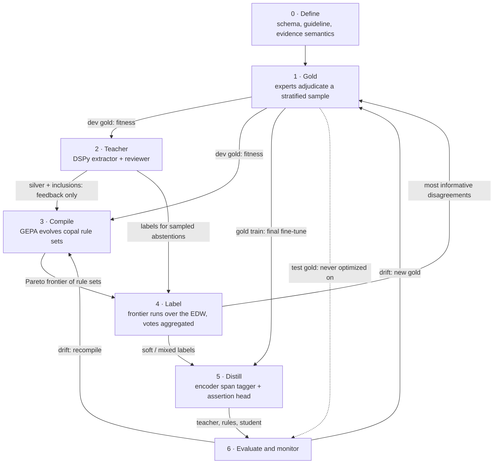
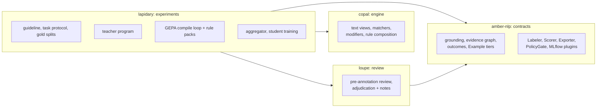
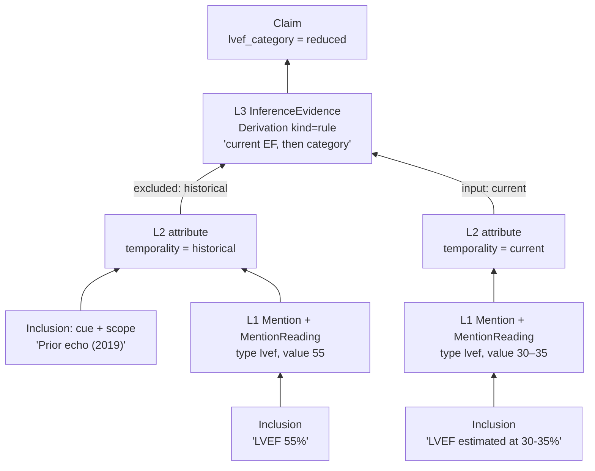
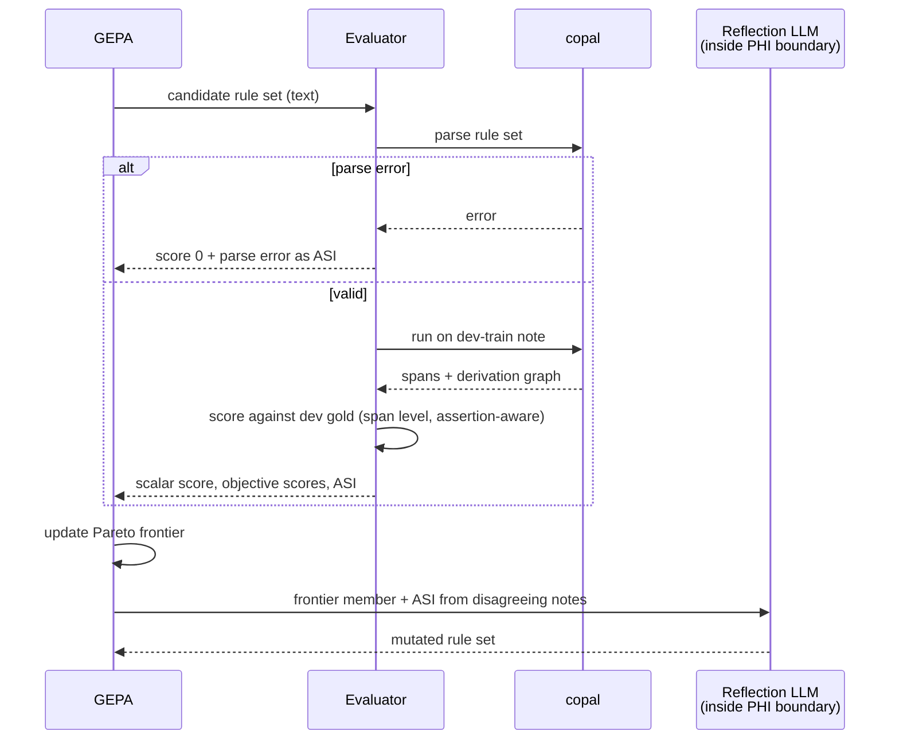
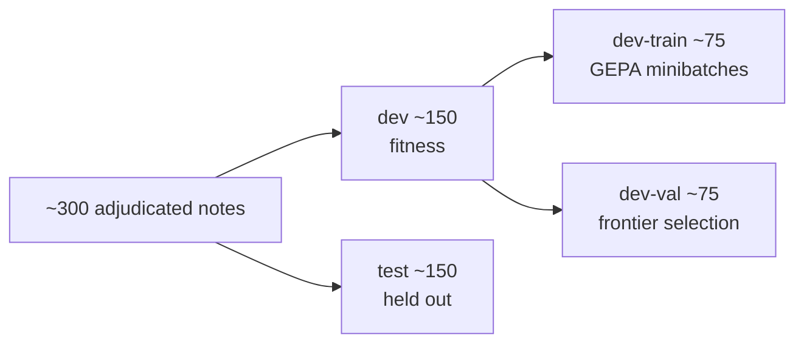

# Compiled Clinical IE: Expert-Guided Evolution of Hierarchical Rules

**Status:** research proposal, not a contract. The work it describes lives in lapidary (experiments),
copal (rule engine), and loupe (review). It is filed here because every artifact it produces must
conform to amber contracts. Nothing in this document changes [contracts.md](../contracts.md).

## Summary

Clinical experts and a frontier LLM define an extraction standard once. An evolutionary search
then **compiles** that standard into hierarchical rules written in copal's rule language. The
rules are fast, deterministic, run on CPU inside the PHI boundary, and can be read by
clinicians. They label the enterprise data warehouse (EDW) at scale and supervise a small,
distilled open model. Because each copal rule fires on exact spans and composes into higher
rules, the rule derivation *is* an amber evidence graph: grounding comes by construction, not by
after-the-fact attribution.

The pipeline shape (LLM → programmatic labels → distilled model) is established. EvoPool (2026)
already evolves labeling functions against a validation set and distills them. This proposal
claims novelty in four places:

1. **Span-level, grounded extraction** with assertion and temporality, where prior work evolves
   rules for discrete labels only.
2. **Expert reasoning as the optimization signal**, with its value in expert-hours measured.
3. **A hierarchical, clinician-reviewable rule language as the compile target**, whose
   derivations are evidence graphs.
4. **Real EHR conditions**: drift across years, note types, and sites, plus patient-level
   roll-up.

One change from the earlier plan matters throughout: **expert effort comes first** (a guideline
and a small gold set), not last. Teacher-produced silver labels supply training volume and
feedback. They are never the fitness signal.

> 🔷 **Novelty callouts** mark the places where this work goes beyond prior art. Everything else
> is established technique, assembled deliberately.

## Contents

1. [Background and terms](#1-background-and-terms)
2. [Prior art and the gap](#2-prior-art-and-the-gap)
3. [The workflow](#3-the-workflow)
4. [Where the work lives](#4-where-the-work-lives)
5. [Stages in detail](#5-stages-in-detail)
6. [copal as the compile target](#6-copal-as-the-compile-target)
7. [Novelty claims](#7-novelty-claims)
8. [First experiment: LVEF and HF phenotype](#8-first-experiment-lvef-and-hf-phenotype)
9. [Risks and mitigations](#9-risks-and-mitigations)
10. [Open questions](#10-open-questions)
11. [Bibliography](#11-bibliography)

Readers who know the weak-supervision and GEPA literature can skip to [§3](#3-the-workflow).
Readers who only want the research claims can read [§7](#7-novelty-claims) and
[§8](#8-first-experiment-lvef-and-hf-phenotype).

---

## 1. Background and terms

The proposal combines three lines of work:

- **Weak supervision.** Instead of hand-labeling training data, write many noisy *labeling
  functions* (small rules that vote or abstain on each example), then combine their votes with
  a *label model* into probabilistic training labels (Snorkel, Data Programming).
- **LLM-compiled systems.** Use an LLM at build time to write a program, then run the program
  without the LLM (Compiled AI, DSPy). ALCHEmist and Evaporate do this for labeling functions.
- **Reflective evolution.** GEPA mutates a text artifact (a prompt, or here a rule set),
  evaluates it, and feeds diagnostic text back to an LLM that proposes the next mutation. Its
  `optimize_anything` API accepts any serializable artifact.

| Term | Meaning in this document |
|---|---|
| **Compile** | Turn expert and LLM knowledge into a deterministic rule set that runs with no LLM. |
| **Teacher** | The LLM extraction program (DSPy extractor plus reviewer) that produces silver labels. |
| **Student** | The small distilled model (an encoder span tagger) trained on the labels. |
| **Gold** | Expert-reviewed references. In amber terms, `Example`s at tier `adjudicated` or `single_review`. |
| **Silver** | Unreviewed references from the teacher or rules. amber tier `silver`. |
| **dev / test** | The two gold splits. *dev* is the optimizer's fitness signal; *test* is never seen by any optimizer. |
| **ASI** | GEPA's *actionable side information*: the diagnostic text an evaluator returns to the reflection LLM (errors in context, which rule fired, notes from experts). |
| **Frontier** | The set of evolved rule sets that no other candidate beats on every objective (a Pareto frontier). |
| **Abstain** | A rule set produces no answer for a note or field. Abstaining is *not* a negative finding. |
| **Assertion** | Whether a mention is affirmed, negated, hypothetical, historical, or about someone else (experiencer), as in ConText. |
| **Level** | A layer of the rule hierarchy: mention matchers, modifiers, note-level composition, and later patient-level roll-up ([§6.1](#61-hierarchical-rules-as-evidence-graphs)). |

amber vocabulary (`Inclusion`, `Mention`, `MentionReading`, `InferenceEvidence`, `Derivation`,
`Claim`, `CaseOutcome`, `Example`) follows [contracts.md](../contracts.md) and
[contract-v0.1.md](contract-v0.1.md).

---

## 2. Prior art and the gap

| Ingredient | Prior art | Status |
|---|---|---|
| LLM writes code at compile time; deterministic runtime | Compiled AI (Trooskens et al., 2026); DSPy (Khattab et al., 2023/24) | Established paradigm |
| LLM-synthesized labeling functions + weak supervision | ALCHEmist (Huang et al., 2024); Evaporate (Arora et al., 2023); DataSculpt (Guan et al., 2025); EXPONA (Lam et al., 2026); Alfred (Yu & Bach, 2023) | Established; one-shot synthesis is weak on specialized tasks |
| **Iterative** labeling-function refinement from validation feedback | LGIWL (2025); **EvoPool (Xu et al., 2026)** | Established for **classification and relation extraction** |
| Reflective evolution of code artifacts | GEPA / `optimize_anything` (Agrawal et al., 2025/26) | Established tool |
| Clinical LLM silver labels → small model | Wei et al. (2024); SHIELD (2026); LLM→BERT clinical NER distillation (2025); synthetic data distillation (2025) | Established |
| Clinical weak supervision with ontologies and rules | Trove (Fries et al., 2021); Snorkel lineage | Established |

**The closest work is EvoPool.** It evolves a pool of Python labeling functions against a
validation set and distills the result into RoBERTa, Qwen, and Llama models. It leaves three
openings:

1. It targets tasks expressible as discrete-label Python rules and states that extractive
   tasks are out of scope.
2. It removes the human author entirely.
3. It evaluates on public English benchmarks, with no drift, site, or note-type shift.

This proposal sits in those three openings.

---

## 3. The workflow



Read the diagram for three properties:

- **Gold is the only fitness signal.** Both optimizers (teacher tuning and rule evolution)
  score against dev gold. Silver feeds the compiler only as explanation in the ASI.
- **Test gold reaches only evaluation.** No optimizer sees it. Stage 6 evaluates every
  artifact (teacher, rule sets, and student), not just the student.
- **There are two loops.** Disagreements in labeling go back to experts as new gold, and drift
  detected in monitoring triggers both new gold and recompilation.

---

## 4. Where the work lives

Following the [charter](../charter.md#ecosystem), amber-nlp owns contracts and checks, not
pipelines.



| Need in this proposal | Provided by | Status |
|---|---|---|
| Exact spans and grounding | amber `quote()`, `mention()` | `quote` exists; `mention` planned (contract v0.1 §2) |
| copal span → amber mention | copal adapter (contract v0.1 §2.4) | Planned |
| Rule derivations as evidence | `InferenceEvidence.derivation` with `kind="rule"` (contract v0.1 §3.4) | Planned |
| Gold / silver separation | `Example` reference tiers (contract v0.1 §4.2) | Planned |
| "Never score a system against its own silver" | `Scorer` configuration check (contract v0.1 §4.2) | Planned |
| Expert review and adjudication notes | loupe via the review bridge | Planned |
| Reflection LLM inside the PHI boundary | `PolicyGate`: zone × sensitivity check | Planned |
| `NOTE_NLP` export | `Exporter` interface | Planned |
| Patient-level roll-up | — | **Charter non-goal** until a contract adopts it ([§10](#10-open-questions)) |

---

## 5. Stages in detail

Each stage lists what it produces and how that output is represented.

### Stage 0: Define

- Experts agree the schema, the annotation guideline, and what counts as evidence: mention
  spans, assertion, temporality, and inference steps.
- Most disagreement in clinical IE is about definitions, so the up-front expert time goes here.
- **Output:** a Pydantic answer model and task definition (in lapidary), plus a versioned
  guideline document.

### Stage 1: Gold

*Moved earlier than in the original plan.*

- Experts adjudicate a sample stratified by note type, service, year, and ideally site.
- They review teacher pre-annotations in loupe rather than labeling from scratch.
- On every correction they write a **free-text adjudication note**. These notes become the
  expert ASI in Stage 3 and are the input to novelty claim N2.
- Split the gold:
  - **dev**, the fitness signal for teacher and compiler. Inside dev, use an 80/20 train/val
    split above 200 examples and 50/50 otherwise.
  - **test**, held out and at tier `adjudicated`, since confirmatory evaluation uses only that
    tier.
- **Output:** gold `Example`s with annotation events and attached notes.

### Stage 2: Teacher

- A DSPy program (extractor plus reviewer) produces silver labels with inclusions. It is tuned
  with `dspy.GEPA` against dev gold.
- The silver labels have three uses:
  1. training volume for the student (Stage 5);
  2. the "teacher evidence" field in the compiler's ASI (Stage 3);
  3. triage for choosing which notes go to experts.
- **Output:** silver `Example`s whose provenance names the teacher configuration.

### Stage 3: Compile into copal

- **Seed.** Generate a first copal rule set in one shot, ALCHEmist-style, from the guideline
  and a handful of examples.
- **Evolve.** GEPA `optimize_anything` mutates the serialized copal rule set. The evaluator
  runs copal on dev, scores at the span level, and returns ASI ([§6.2](#62-the-evolution-loop)).
- **Score on several objectives:** precision, recall, coverage, abstention calibration,
  assertion accuracy, and simplicity (rule count and depth).
- **Keep the frontier.** Persist all Pareto-frontier rule sets for aggregation in Stage 4,
  not only the single best.
- **Selection hygiene**, borrowed from EvoPool's gate:
  - require a precision floor and a minimum firing count;
  - deduplicate rules with near-identical firing patterns;
  - drop a newly added rule if removing it improves the dev score.
- **Choose ASI examples by disagreement.** Show the reflection LLM notes on which frontier
  members disagree (in the spirit of BatchBALD), rather than random notes.
- **Output:** a frontier of rule sets, each identified as `rule:<ruleset>@<version>+<hash>`.

### Stage 4: Label the corpus

- Run the copal frontier over the EDW. Being Rust on CPU, this is cheap and stays inside the
  PHI boundary.
- **Aggregate** the frontier's votes with a text-aware label model (votes plus embeddings),
  not majority vote.
- **Abstention is not a negative.** Send a stratified sample of abstentions and disagreements
  to the teacher, and the most informative ones to experts (back to Stage 1).
- **Provenance on every label:** rule ID and derivation, teacher, or expert. Labels export to
  OMOP `NOTE_NLP` with evidence links.
- **Output:** silver `Example`s; the aggregated frontier acts as an amber `Labeler`.

### Stage 5: Distill

- The first student is an encoder span tagger with an assertion and temporality head, such as
  BioClinical ModernBERT or DeBERTa. It is cheap, deterministic at inference, and runs locally.
- Train on **soft and mixed labels** (rules everywhere, teacher on hard cases), then fine-tune
  on gold train.
- **Ask what the student is for.** For templated fields, copal itself may be the deployment
  artifact. The student earns its place on judgment-heavy fields where rules abstain.
- Keep copal running beside the student as a **verifier and explainer**. When they disagree,
  the note goes to the expert queue (novelty claim N7).

### Stage 6: Evaluate and loop

- Evaluate every artifact against test gold: teacher, best single rule set, aggregated
  frontier, and student.
- Monitor coverage and abstention rate per note type. A threshold breach triggers new gold
  sampling (Stage 1) and recompilation (Stage 3).
- Log to MLflow through the OSS API (Databricks is configuration only): guideline version, gold
  set version, teacher prompts and model, copal rule-set hash, aggregator, student weights,
  and evaluation results.

---

## 6. copal as the compile target

copal is a Rust engine in the medspaCy tradition: exact-offset text views, target matching,
ConText-style modifiers, sectioning, and rule composition. Its spans already carry a
`rule_id` and the IDs of their input spans. Fully hierarchical rule sets are planned.

**Why copal is a better target than free Python:**

- **Smaller search space.** Evolution proposes rule specs in a DSL, not arbitrary code. There
  are fewer degenerate solutions, no sandbox to escape, and the mutations are more meaningful.
  This is in the spirit of syntax-guided synthesis.
- **Reviewable by clinicians.** Rules read like the guideline, so review can be part of the
  protocol.
- **Speed and placement.** It runs on CPU over millions of notes inside Databricks or Azure,
  with no GPU and no model provider.
- **Lineage.** It builds on ConText and medspaCy, which clinical NLP already trusts.

### 6.1 Hierarchical rules as evidence graphs

Flat labeling functions vote. Hierarchical rules *derive*. Each level consumes the output of
the level below:

| Level | Rules | Example failure the ASI can name |
|---|---|---|
| L1 Mentions | matchers over text, with captures | "LVEF phrase missed" |
| L2 Modifiers | assertion and temporality, ConText-style cue + scope | "mention found, temporality wrong" |
| L3 Note | composition of modified mentions into answers | "both EFs found, wrong one selected" |
| L4 Patient | roll-up across notes (future; see [§10](#10-open-questions)) | "most recent EF taken from the wrong date" |

A synthetic example. The note contains:

> `Prior echo (2019): LVEF 55%. Today: LVEF estimated at 30-35%.`

The rule set should report the current EF category as *reduced*. Its derivation, mapped to
amber objects:



Arrows show the direction of derivation; amber's `EvidenceEdge`s point the other way, from the
claim to its support. Every branch ends in an `Inclusion`, which is exactly the
"source-backed leaves" check amber's graph validation already enforces.

| copal output | amber object | Reference |
|---|---|---|
| L1 span with `start`, `end`, `quote`, captures | `Mention` + `MentionReading` (status `proposed`) | contract v0.1 §2.4 |
| L2 modifier `{value, trigger_id, scope_id}` | `MentionReading.attributes`, with cue and scope `Inclusion`s | contract v0.1 §2.4 |
| L3 composition rule application | `InferenceEvidence` with `Derivation(kind="rule", name, version, inputs)` | contract v0.1 §3.4 |
| Note-level answer | `Claim`, final in `CaseResult` | contracts.md |
| No answer from the rule set | Not `not_mentioned` by default; see [§10](#10-open-questions) | — |

> 🔷 **Novelty: hierarchical rules as the evidence graph.**
> If every copal derivation is recorded this way, the compiled artifact emits exactly the
> evidence structure amber requires: inclusions at the leaves, rule derivations at the internal
> nodes. Grounding comes by construction, not by post-hoc attribution. And because a rule
> derivation is replayable, amber's conformance kit can re-run it and check the claim.
>
> The hierarchy also enables **level-wise evolution**. GEPA can mutate L1 matchers, L2
> modifiers, or L3 composition separately, and attribute each error to the level that failed.
>
> To our knowledge, no work on labeling-function synthesis or evolution compiles into a
> hierarchical, derivation-producing rule language.

### 6.2 The evolution loop



Each ASI item for a missed span names the failed level, the teacher's inclusion for that span,
and the expert's adjudication note. The expert note is the ingredient whose value N2 measures.

### 6.3 Evaluator sketch

> This assumes copal exposes Python bindings (for example via PyO3) and serializes rule sets as
> text. The API pattern follows the GEPA docs; helper functions are placeholders.

The scalar score is $F_{0.5}$, which weights precision twice as heavily as recall, because a
wrong rule label is more costly downstream than an abstention that the teacher can fill in.

```python
import gepa.optimize_anything as oa
from gepa.optimize_anything import optimize_anything, GEPAConfig, EngineConfig
import copal  # Python bindings to the Rust engine

ANTI_OVERFIT = (
    "Do NOT copy note-specific phrases, patient details, or template fragments "
    "into rules. Generalize across note types and sites. Preserve the output "
    "schema (Inclusions + derivation)."
)

def evaluate(candidate: dict, example) -> tuple[float, dict]:
    try:
        rules = copal.RuleSet.from_text(candidate["copal_rules"])  # parse = validation
    except copal.ParseError as e:
        return 0.0, {"Error": f"copal parse error: {e}"}

    result = rules.run(example["note_text"])        # spans + derivation graph
    m = score_against_gold(result, example["gold"])  # span-level, assertion-aware

    for fp in m.false_positives[:5]:
        oa.log(f"FP: {fp.context!r}; derivation: {fp.derivation}")
    for fn in m.false_negatives[:5]:
        oa.log(f"MISSED: {fn.context!r}; failed level: {fn.failed_level}; "
               f"teacher evidence: {fn.teacher_inclusion}; "
               f"adjudicator note: {fn.expert_note}")

    return m.f_beta(beta=0.5), {
        "scores": {                     # Pareto objectives, higher is better
            "precision": m.precision,
            "recall": m.recall,
            "coverage": m.coverage,
            "assertion_acc": m.assertion_accuracy,
            "simplicity": 1.0 / (1.0 + rules.size() / 200),
        },
        "Constraint": ANTI_OVERFIT,
    }

result = optimize_anything(
    seed_candidate={"copal_rules": seed_rules_text},
    evaluator=evaluate,
    dataset=dev_train,
    objective="Evolve copal hierarchical rules that extract grounded LVEF / HF evidence.",
    config=GEPAConfig(
        engine=EngineConfig(max_metric_calls=1500, run_dir="./runs/lvef"),
        reflection_lm=phi_boundary_lm,  # callable → model inside the PHI boundary
    ),
)
```

---

## 7. Novelty claims

Ranked by strength and fit. The suggested headline is **N1 + N2 + N3**; the rest are supporting
results.

| Claim | One-line question | Tested by experiment arms ([§8](#8-first-experiment-lvef-and-hf-phenotype)) |
|---|---|---|
| N1 Span-level evolution | Does evolution close the gap to the teacher for spans as it does for classes? | 1, 2, 3–5 |
| N2 Expert reasoning as signal | What is an expert note worth, per expert-hour? | 3 vs 4 vs 5 |
| N3 Hierarchical DSL | Does structure improve accuracy, robustness, and reviewability? | 6, plus clinician review |
| N4 EHR shift | Does monitoring catch drift early, and how cheap is recovery? | Later; needs multi-year data |
| N5 Patient roll-up | Can rules match an LLM reading the full record? | Later; blocked on contract |
| N6 Compilability economics | What fraction of accuracy survives compilation, and at what cost? | All arms |
| N7 copal as verifier | Does student + verifier beat either alone? | 7, 8 |

> 🔷 **N1: Evolutionary compilation for grounded span-level clinical IE.**
> Prior evolution of labeling functions (EvoPool, LGIWL) covers discrete labels. Here the target
> is span extraction with assertion, temporality, and experiencer, scored at the span level,
> with evidence links.
> *Questions:* Does iterative evolution close the gap to the teacher for spans as it does for
> classes? Which phenomena stay uncompilable?
> *Evidence:* a per-phenomenon compilability table (numeric EF, narrative EF, negated or
> historical HF) comparing teacher, one-shot seed, evolved copal, and student.

> 🔷 **N2: The value of expert reasoning as an optimization signal.**
> EvoPool removes the human. LGIWL uses classifier errors. Neither measures what a clinician's
> *reasoning* is worth.
> *Ablation:* ASI with labels only, then adding teacher evidence, then adding expert
> adjudication notes, at matched expert-hours.
> *Headline result:* a **cost-per-F1-point curve for expert time**, directly useful to anyone
> budgeting clinical annotation.

> 🔷 **N3: A hierarchical rule DSL as compile target, with derivations as evidence graphs.**
> Compile into copal's hierarchical rules rather than flat Python labeling functions.
> *Comparisons:* (a) free Python vs. flat copal vs. hierarchical copal on accuracy, robustness,
> and size; (b) **clinician reviewability**, measured as time-to-review and the rate at which
> clinicians auditing sampled rules detect planted or real errors; (c) level-wise vs.
> whole-artifact mutation in GEPA.
> *Claim to test:* grounding by construction, and better generalization from the structural
> prior.

> 🔷 **N4: Robustness under real EHR shift, and drift-triggered recompilation.**
> Benchmarks cannot test this; the EDW can.
> *Measure:* degradation across note types, years (Epic template changes), and ideally sites,
> for copal, teacher, and student.
> *Test:* whether coverage and abstention monitoring detects drift before accuracy drops, and
> how cheaply recompilation recovers.

> 🔷 **N5: Patient-level roll-up through hierarchical rules.**
> Extend the hierarchy above the note (level L4): temporal aggregation and conflict resolution
> across notes, such as "most recent EF" or "ever HFrEF".
> *Comparison:* rule-derived patient phenotypes vs. a teacher LLM reading the full record vs.
> structured-data phenotypes, on chart-reviewed gold.
> *Dependency:* amber has no patient-level contract yet ([§10](#10-open-questions)).

> 🔷 **N6: Compilability profile and economics.**
> Across several phenotypes, measure the fraction of teacher (or gold) accuracy retained per
> compile target, compile-time cost, expert-hours, and runtime cost per million notes on CPU
> inside the PHI boundary. This is a practical contribution even where the method contributions
> are incremental.

> 🔷 **N7: copal as verifier for the student.**
> Use rule–model disagreement as (a) a runtime confidence signal, (b) an active-learning query,
> and (c) an auditable explanation of model outputs.
> *Question:* Does a hybrid student + verifier dominate either alone on precision at fixed
> coverage?

---

## 8. First experiment: LVEF and HF phenotype

**Task.** Extract the LVEF value and the HF phenotype (HFrEF, HFmrEF, HFpEF) from echo reports
and cardiology notes. The task mixes content that should compile easily (numeric EF in echo
reports) with judgment-heavy content (narrative EF such as "mildly reduced", temporality,
"history of"). The [§6.1](#61-hierarchical-rules-as-evidence-graphs) example is this task.

**Gold.** About 300 expert-adjudicated notes, stratified by note type and year, with
adjudication notes captured.



**Arms.**

| # | Arm | Answers |
|---|---|---|
| 1 | Teacher (DSPy + GEPA) | Upper reference for compilation (N1, N6) |
| 2 | One-shot copal seed, ALCHEmist-style | Baseline without evolution (N1) |
| 3 | Evolved copal, ASI = labels only | N1, N2 baseline |
| 4 | Evolved copal, + teacher evidence | N2 |
| 5 | Evolved copal, + teacher evidence + expert notes | N2 |
| 6 | Flat vs. hierarchical copal | N3 |
| 7 | Student trained on teacher silver only | N7 baseline |
| 8 | Student on aggregated copal + teacher hard cases, then gold fine-tune | N7, main deployable |

**Metrics.** Span-level precision, recall, and F1; assertion accuracy; coverage; abstention
calibration; expert-hours; compile cost; runtime per million notes; rule-set size and depth;
and clinician review time on a sample of rules.

---

## 9. Risks and mitigations

| Risk | Mitigation |
|---|---|
| **PHI in the reflection loop**: ASI contains note text | `reflection_lm` is a callable that reaches only a model inside the PHI boundary, checked by amber's policy gate; or use de-identified or synthetic dev data |
| **Compiling the teacher's errors** | Fitness is expert gold only; silver is feedback and training volume; the `Scorer` refuses silver references from the configuration under test |
| **Template memorization and overfitting** | Split by patient, time, note type, and site; anti-overfit constraint in the ASI; DSL constraints (no literal note fragments); untouched test gold |
| **Metric gaming** (abstain on everything hard) | Coverage and abstention calibration as Pareto objectives; abstention-aware recall |
| **Coverage bias passed to the student** | Never treat abstention as negative; text-aware aggregation; teacher labels on sampled abstentions; provenance on every label |
| **Student capped by rule-shaped labels** | Soft and mixed labels; gold fine-tuning; evaluate the student against gold, never against copal |
| **"Readable" rules no one can review** | Simplicity objective; depth limits; measured clinician review (N3) |
| **Drift** | Coverage and abstention monitoring with recompile triggers (N4) |

---

## 10. Open questions

1. **How does abstention map to `CaseOutcome`?** A rule set that finds nothing has not shown
   that the finding is absent. amber reserves `not_mentioned` for evidence-backed absence with
   declared review coverage. Candidates are `insufficient_evidence` with a reason, or no
   `CaseResult` at all with the abstention recorded by the `Labeler`. This needs a decision
   before Stage 4 emits labels.
2. **Patient-level roll-up (L4, N5)** is a charter non-goal until a contract adopts it. N5
   either waits for that contract or stays inside lapidary as an experiment-only output.
3. **copal prerequisites:** hierarchical rule sets, Python bindings, and a stable text
   serialization for rule sets are all assumed above and are not yet built.
4. **Frontier provenance:** the aggregated frontier is several rule sets plus a label model.
   A single `Provenance.producer` string may not describe it; the `Labeler` may need to record
   the member rule-set hashes.
5. **Replay cost:** replaying every rule derivation in the conformance kit is cheap per note but
   may be worth sampling at EDW scale.

---

## 11. Bibliography

**Compiled and programmatic LLM systems**

1. Trooskens G., Karlsberg A., Sharma A., De Brouwer L., Van Puyvelde M., Young M., Thickstun J., Alterovitz G., De Brouwer W. A. *Compiled AI: Deterministic Code Generation for LLM-Based Workflow Automation.* arXiv:2604.05150 (2026). https://arxiv.org/abs/2604.05150
2. Khattab O., Singhvi A., Maheshwari P., et al. *DSPy: Compiling Declarative Language Model Calls into Self-Improving Pipelines.* arXiv:2310.03714 (2023); ICLR 2024. https://github.com/stanfordnlp/dspy
3. Agrawal L. A., Tan S., Soylu D., et al. *GEPA: Reflective Prompt Evolution Can Outperform Reinforcement Learning.* ICLR 2026 (Oral). arXiv:2507.19457. https://github.com/gepa-ai/gepa
4. GEPA project. *optimize_anything* API and documentation (2026). https://gepa-ai.github.io/gepa/

**LLM-synthesized and evolved labeling functions**

5. Huang T.-H., Cao C., Bhargava V., Sala F. *The ALCHEmist: Automated Labeling 500x CHEaper than LLM Data Annotators.* NeurIPS 2024 (Spotlight). arXiv:2407.11004. https://github.com/SprocketLab/Alchemist
6. Arora S., Yang B., Eyuboglu S., Narayan A., Hojel A., Trummer I., Ré C. *Language Models Enable Simple Systems for Generating Structured Views of Heterogeneous Data Lakes* (Evaporate). PVLDB 17(2):92–105 (2023). doi:10.14778/3626292.3626294. https://github.com/HazyResearch/evaporate
7. Xu T., Zhang Y., Ouyang X., Wang H. *EvoPool: Evolutionary Programmatic Annotation for Label-Efficient Specialized Supervision.* arXiv:2606.01617 (2026). https://github.com/tianyi0216/EvoPool
8. *Iterative Weak Supervision with LLM-Guided Labeling Function Refinement* (LGIWL). Proceedings of ISP RAS 37(6):65–76 (2025). https://ispranproceedings.elpub.ru/jour/article/view/2067
9. Guan N., Chen K., Koudas N. *DataSculpt: Cost-Efficient Label Function Design via Prompting Large Language Models.* EDBT 2025, 226–232.
10. Lam P., Nguyen H.-L., Nguyen T.-T., Nguyen S., Vo H. D. *Structured Exploration and Exploitation of Label Functions for Automated Data Annotation* (EXPONA). Knowledge-Based Systems (2026), 115843.
11. Yu P., Bach S. *Alfred: A System for Prompted Weak Supervision.* ACL 2023 System Demonstrations, 479–488.

**Weak supervision foundations**

12. Ratner A., De Sa C., Wu S., Selsam D., Ré C. *Data Programming: Creating Large Training Sets, Quickly.* NeurIPS 2016.
13. Ratner A., Bach S. H., Ehrenberg H., Fries J., Wu S., Ré C. *Snorkel: Rapid Training Data Creation with Weak Supervision.* PVLDB 11 (2017).
14. Zhang T., Cai L., Li J., Roberts N., Guha N., Sala F. *Stronger Than You Think: Benchmarking Weak Supervision on Realistic Tasks.* NeurIPS 2024 Datasets & Benchmarks.
15. Kirsch A., van Amersfoort J., Gal Y. *BatchBALD: Efficient and Diverse Batch Acquisition for Deep Bayesian Active Learning.* NeurIPS 2019.

**Clinical weak supervision, distillation, and rules**

16. Fries J. A., Steinberg E., Khattar S., et al. *Ontology-Driven Weak Supervision for Clinical Entity Classification in Electronic Health Records* (Trove). Nature Communications 12 (2021).\*
17. *Leveraging Large Language Models for Knowledge-Free Weak Supervision in Clinical Natural Language Processing.* Scientific Reports (2024). https://www.nature.com/articles/s41598-024-68168-2
18. *SHIELD: A Diverse Clinical Note Dataset and Distilled Small Language Models for Enterprise-Scale De-identification.* arXiv:2605.03301 (2026).
19. *Distilling Large Language Models for Efficient Clinical Information Extraction.* arXiv:2501.00031 (2025).
20. *Synthetic Data Distillation Enables the Extraction of Clinical Information at Scale.* (2025). https://pmc.ncbi.nlm.nih.gov/articles/PMC12065832/ ; code: https://github.com/bbj-lab/clinical-synthetic-data-distil
21. Eyre H., Chapman A. B., Peterson K. S., et al. *Launching into Clinical Space with medspaCy: A New Clinical Text Processing Toolkit in Python.* AMIA Annual Symposium Proceedings 2021. arXiv:2106.07799.\*
22. Harkema H., Dowling J. N., Thornblade T., Chapman W. W. *ConText: An Algorithm for Determining Negation, Experiencer, and Temporal Status from Clinical Reports.* Journal of Biomedical Informatics 42(5) (2009).\*

\* *From prior knowledge; not re-verified. Confirm author lists and volume details before
submission. Entries without authors were verified by title and venue only; fill in authors from
the source.*
