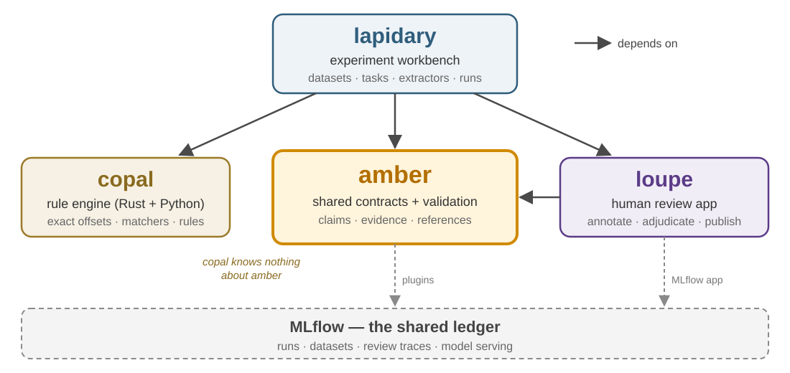
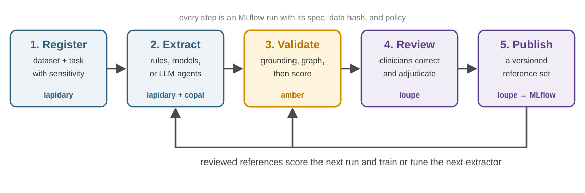

<!-- _class: lead -->
<!-- _paginate: false -->
<!-- _header: '' -->

# The amber projects

Evidence-grounded clinical information extraction,
built from four small, replaceable pieces

amber · copal · lapidary · loupe

<!--
Audience: clinical informatics and research colleagues. No clinical data appears
in this deck; the note excerpt on slide 4 is invented.
-->

---

# The problem

We want structured variables (ejection fraction, tumor stage, symptoms) from clinical notes.

- There are many ways to get them: **rules, ML models, LLM agents, human abstractors**.
- Each produces output in its own shape, so results are **hard to compare**.
- An answer without a pointer to the text is **hard to trust** and hard to check.
- Expert review is expensive, and its corrections usually **don't get reused**.

We keep rebuilding the same plumbing for every project and every method.

---

# The vision

## One shared definition of an answer

Every extracted value is a **claim** that points at the **exact text** supporting it.

Any method, whether rules, model, agent, or person, produces the same kind of result, checked by the same code.

## Three properties

1. **Grounded.** Every answer traces back to a verified span of the note.
2. **Replaceable.** Swap a rule set for an LLM and nothing downstream changes.
3. **Cumulative.** Clinician review becomes reusable reference data, not throwaway corrections.

---

# The core idea: a claim plus its evidence

An invented note:

> Echo today: <mark>LVEF 30%</mark>. Denies chest pain.

| Part | What it records |
|---|---|
| **Claim** | variable `lvef` = **30** |
| **Evidence** | the quote `"LVEF 30%"` at characters 12–20, checked to equal `text[12:20]` exactly |
| **Provenance** | who produced it (e.g. `rule:lvef@1`, `model:…`, `human:…`), when, and under what data policy |

If the quote doesn't match the note character for character, the claim **cannot be recorded**. No method can skip this check.

---

# Four projects, one metaphor

| Project | The word means… | Its job |
|---|---|---|
| copal | young resin, on its way to becoming amber | Fast rule engine that finds text spans at exact offsets |
| amber | the hardened, preserved result | The contracts: what an extraction result *is* and how it's checked |
| lapidary | the craftsperson who cuts and polishes amber | The workbench where experiments run on real datasets |
| loupe | the jeweler's magnifying glass | The app where clinicians inspect, correct, and adjudicate |

Each project is a separate repository with its own release cycle.

---

# How they fit together

Arrows point toward amber's contracts. amber itself imports none of the others.

---

# amber: the contracts

**Owns:** what a result looks like, and the checks that make it trustworthy.

- **Data models** for notes, mentions, claims, evidence, cases, and reference examples
- **Validation**: exact grounding, evidence-graph checks, outcome consistency, data-policy rules
- **Interfaces** that implementations satisfy, e.g. `Extractor.run(case) -> CaseResult`
- **Conformance kit**: adversarial tests any implementation runs on its own output
- **Optional MLflow plugins**: scoring, datasets, the loupe bridge, deployment

amber does not extract anything itself. It is the referee, not a player.

---

# copal: the rule engine

**Owns:** fast, explainable, rule-based text matching. Domain-neutral; it contains no clinical content.

- Rust core with Python bindings; runs on CPU, in batch
- Matches on a normalized view of the text (lowercase, collapsed whitespace) but reports **offsets in the original text**, so amber's exact-quote check holds
- Dictionary and regex matchers, span operators (inside, near, blocked by…), sections, sentences, and negation/context modifiers (the ConText algorithm)
- Rules are **versioned data files** with a content hash, so every match records which rule produced it

Clinical rule sets that use copal live in lapidary, not in copal.

---

# lapidary: the workbench

**Owns:** everything specific to an experiment.

- **Datasets** (registered with a sensitivity level, stored outside the repo), task definitions, extractors, baselines, and run reports
- A CLI, `lap`, designed so a **coding agent** can run experiments and a human can still see what was run, on what data, and why
- Every method writes the same amber-shaped output, so scoring and comparison work for all of them
- Every run is logged to MLflow with its spec, data hash, git commit, and data-policy zone
- **PHI is enforced by code**: a policy gate blocks sending sensitive data to providers that aren't allowed to receive it

---

# loupe: human review

**Owns:** turning clinician judgment into reference data.

- An MLflow app: reviewers select text, choose a concept, set context (negated? historical? family?), and submit. **No JSON editing.**
- Every revision is kept; a reference set is published **only after explicit adjudication**
- Output is a versioned MLflow Dataset that amber can load as reference **Examples**, tagged by quality tier: *adjudicated*, *single review*, or *silver* (machine-only)

Review work becomes a reusable asset for scoring the next method.

---

# The loop

The same reference set can score a rule set, a fine-tuned model, and an LLM agent side by side.

---

# Boundaries we keep

- **Dependencies point inward.** amber's core needs only Pydantic and python-ulid; `import amber` never loads MLflow or a model.
- **Experiments stay out of the libraries.** No datasets, prompts, or clinical rules in amber or copal.
- **Validation lives in one place.** Implementations call amber's checks; they never reimplement them.
- **A contract becomes stable only when a real consumer uses it** and the conformance kit tests it.
- **No PHI in any repository.** Examples and tests are synthetic.

---

# Where things stand (November 2026)

| Project | Status |
|---|---|
| amber | Reset on 2026-10-29 around the contracts. Data models, grounding, and evidence-graph validation are in place. Interfaces, conformance kit, and MLflow plugins are in progress. |
| copal | Preparing its 0.1 release (release candidate built) |
| loupe | Working MLflow review app; amber bridge to come |
| lapidary | Workbench and `lap` CLI under construction; first experiments planned on CORAL and institutional notes |

No clinical performance results are claimed here.

---

<!-- _class: lead -->

# In one sentence

**amber** defines a trustworthy answer,
**copal** finds text fast,
**lapidary** runs the experiments,
and **loupe** lets clinicians check the results.

Start with amber-nlp/docs/charter.md

